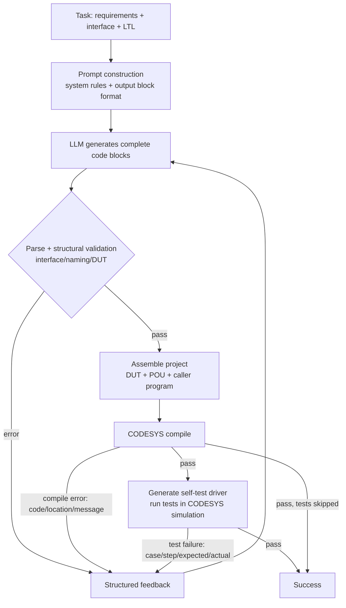

# Automatic ST Code Generation for the CODESYS Platform — Experiment Report

> English translation of [`实验报告.md`](实验报告.md). Section numbering, tables and the
> architecture diagram are kept identical to the Chinese original; the appendix is
> translated separately in [`Appendix_EN.md`](Appendix_EN.md). Task IDs, file paths, model
> ids and error codes are left untranslated.

## Abstract

This work implements an ST (Structured Text) code generation system for the CODESYS
platform, comprising five parts: **dataset and formal specifications, a self-built
lightweight agent harness, a CODESYS compile service, CODESYS simulation-based
behavioural testing, and a unified evaluation pipeline**. On 30 PLC programming tasks
(20 public + 10 self-built) we run a four-setting comparison of
"existing framework (Codex CLI) × self-built harness" against "DeepSeek × Qwen".

Main results (30 tasks, at most 5 compile-feedback rounds):

| Setting | First-round compile | Final compile | Tests pass | End-to-end success | Avg. rounds | Avg. wall time |
|---|---|---|---|---|---|---|
| Self-built harness + DeepSeek | 96.7% | 100.0% | **83.3%** | 83.3% | 1.77 | 163 s |
| Self-built harness + Qwen | 76.7% | 93.3% | **66.7%** | 66.7% | 2.53 | 295 s |
| Codex CLI + DeepSeek | 100.0% | 100.0% | **83.3%** | 83.3% | 1.70 | 342 s |
| Codex CLI + Qwen | 30.0% | 83.3% | **46.7%** | 46.7% | 3.53 | 315 s |

Conclusions: with DeepSeek the two frameworks tie on test pass rate (83.3%), while the
self-built harness uses about 1/7 of Codex's input tokens and about 1/2 its wall time.
With Qwen the self-built harness remains clearly better (66.7% vs 46.7%). The
framework × model interaction is substantial; see Section 5.

---

## 1. Experimental Environment

| Item | Configuration |
|---|---|
| Operating system | Windows 11 Pro 10.0.26300 |
| PLC development environment | CODESYS V3.5 SP22 Patch 4 (x64), device template Control Win V3 x64 |
| Standard library | Standard 3.5.22.0 (referenced automatically by the compile service) |
| Runtime | CODESYS built-in soft-PLC simulation (`set_simulation_mode` + OnlineApplication) |
| Script hosts | CODESYS embedded IronPython 2.7 (worker); client CPython 3.12.5 (standard library only) |
| Model gateway | DMXAPI (OpenAI-compatible, `https://www.dmxapi.cn/v1`; the Responses endpoint also works) |
| Models | DeepSeek `deepseek-v4.1-flash-1017`; Qwen `qwen3.7-flash` |
| Existing-framework baseline | Codex CLI 0.164.0 (`codex exec`, custom provider pointing at DMXAPI) |
| Sampling parameters | Self-built harness: temperature 0.1, max_tokens 16384, 3 retries; Codex temperature controlled by the framework default |
| Repair budget | Identical for both frameworks: at most 5 rounds, same feedback text, same compile/test pipeline |
| Timeouts | LLM call 240 s (Codex 900 s); compile batch 300 s; single simulation group 600 s |
| Concurrency | CODESYS is a single serial instance (to avoid multi-instance conflicts); tasks run one at a time |

**Integration details**

- The self-built harness calls DMXAPI directly through the OpenAI-compatible Chat
  Completions API; the API key lives only in `.env` (ignored by `.gitignore`; the
  repository keeps only `.env.example`).
- Codex CLI overrides its configuration with `-c model_providers.dmxapi.*` to point at
  DMXAPI and uses `wire_api="responses"` (0.164 has removed the chat protocol), with a
  `read-only` sandbox and `--ephemeral`; only its final message is taken as the generated
  output.

**Resource limits**

- At most 5 repair rounds per task; termination conditions include "code unchanged"
  (stalled) and "same failure signature repeated" (no_progress), to avoid useless loops.
- Infrastructure failures (template/simulation/tool exceptions) are recorded as
  `tool_error`, **reported separately and excluded from model capability**; before the
  end of the experiments every `tool_error` was retried down to zero.

---

## 2. Dataset and Formal Specifications

### 2.1 Composition

| Dimension | Count |
|---|---|
| Total tasks | 30 (20 public + 10 self-built) |
| Difficulty | easy 9 / medium 12 / hard 9 |
| Formal specifications | 75 (2.5 per task on average) |
| Test cases | 54 groups, 199 scan steps (every step has a test purpose; see §2.6 and `report/测试用例.md`) |

Every task uses a uniform `FUNCTION_BLOCK` interface (the "program-type" public tasks were
adapted into function blocks, see 2.3), and comes with: bilingual requirements, a
structured interface (inputs / outputs / in-outs / DUTs), LTL specifications, behavioural
test cases, and a reference implementation that compiles and passes the tests. The data
schema is in `dataset/schema.md`; **the per-task test-case document organised according to
the assignment template is [`report/测试用例.md`](测试用例.md)**.

### 2.2 Provenance and Adaptation Log

**Public tasks (20)**: taken from the course-provided `公共题库.json` (easy 6 / medium 8 /
hard 6); the original form is an English requirement plus an interface table. Our
processing:

1. Structural interface (name/type/direction), plus a Chinese requirement text;
2. Per-task LTL specifications and behavioural test cases;
3. Reference implementations that pass CODESYS compilation and simulation tests;
4. Program-type tasks (e.g. "automated production line control", "flexible machining")
   were uniformly changed to function-block interfaces, with the external state supplied
   by the caller program in the test driver, so they remain testable.

**Self-built tasks (10; 3 easy / 4 medium / 3 hard)**: all independently conceived around
common PLC scenarios rather than copied from external sources; each records its scenario
and focus in `meta.scenario`:

| ID | Task | Difficulty | Scenario / focus |
|---|---|---|---|
| self_easy_001 | Two-phase traffic light | easy | Timed phase switching, green-light mutual exclusion |
| self_easy_002 | Tank level with high-high alarm | easy | Hysteretic start/stop, over-limit alarm |
| self_easy_003 | Automatic door control | easy | State machine, hold delay, obstacle re-open |
| self_medium_001 | Conveyor height sorting | medium | Edge triggering, range classification |
| self_medium_002 | Duty/standby pump alternation | medium | Edge-triggered alternation, feedback-timeout pump switch |
| self_medium_003 | Alarm latching with acknowledge/reset | medium | Latch / acknowledge / reset priority |
| self_medium_004 | Star-delta reduced-voltage start | medium | Timed transition, contactor interlock |
| self_hard_001 | Parking lot occupancy counting | hard | Bidirectional edge counting, capacity constraint |
| self_hard_002 | Constant-pressure multi-pump staging | hard | Staged pump start/shed, dead band |
| self_hard_003 | Three-floor elevator control | hard | Target floor, arrival detection, door-open delay |

**Data plausibility**: every self-built task maps to a real PLC scenario (traffic, water
utility, door access, sorting, pump station, motor starting, parking, elevator). Interfaces
are 2–8 inputs and 1–6 outputs, consistent with the size of industrial function blocks.
The difficulty gradient comes from the number of states, the timer/edge semantics and the
number of constraints, not from artificial padding.

### 2.3 Key Adaptations

| Task | Original form | Adaptation | Rationale |
|---|---|---|---|
| FIFO queue (public_hard_006) | `VARIANT` generic `buffer/item` | Elements fixed to `INT` + `ARRAY[*]` buffer, capacity derived from the actual argument | The current script-created CODESYS project does not support `VARIANT`/`__VARCINFO`; queue semantics are unchanged after adaptation |
| Program-type public tasks (3) | Global `PROGRAM` | `FUNCTION_BLOCK` + input/output interface | Unify testing and driving for a fair evaluation |
| Analog batch processing | Variable-length `ARRAY[*]` | `ARRAY[*]` kept, capacity hint noted in the interface | CODESYS supports `LOWER_BOUND/UPPER_BOUND`, so no rewrite is needed |

### 2.4 Diversity

- **Scenarios**: discrete manufacturing (sorting, production line, robotic arm), process
  industry (level, batching, constant-pressure supply), motor control (start/stop,
  star-delta), alarms and safety (emergency stop, latching, hysteresis), counting and
  queues, string parsing (IPv4).
- **Data types**: `BOOL/INT/DINT/UINT/USINT/WORD/DWORD/UDINT/REAL/LREAL/TIME/LTIME/
  STRING/ARRAY/ARRAY[*]/STRUCT/ENUM`; 3 tasks involve DUTs, 4 use `VAR_IN_OUT`, 2 use
  `ARRAY[*]`.
- **Semantic features**: edge triggering, timers (TON/TOF), state machines,
  mutual exclusion / priority, boundaries and error codes.

### 2.5 Formal Specification Method

Each task uses LTL to describe safety and functional properties, with notation `G`
(always), `F` (eventually), `X` (next), and logic `! && || ->`. Typical patterns:

- Safety: mutual exclusion `G(!(A && B))`, emergency-stop priority `G(!EStop -> !Motor)`;
- Functional: response `G(cond -> X(output))`, maintenance `G(Start -> F(Run))`;
- Invariants: range constraints `G(0 <= count && count <= capacity)`, monotonicity
  `G(count <= X(count))`;
- Error handling: `G(badInput -> status = 16#8001)`.

The specifications serve two purposes: behavioural constraints in the prompt, and
traceable design grounds for the test cases. **They are not hooked up to PLCVerif** (a
bonus item left for later); the specifications are not machine-verified, which the report
states explicitly.

### 2.6 Test Cases and Dataset Self-Check

- Execution semantics: each test case initialises an independent instance of the function
  block under test (note: "DUT" elsewhere in this report means *data unit type*); step by
  step it "sets inputs → runs one scan cycle → asserts outputs"; `repeat` means the inputs
  are held for N cycles and asserted once at the N-th cycle.
- **Assertion scope**: the driver compares only the outputs (and their struct
  members / array elements) listed in `expect`; unlisted outputs are not checked. Hence
  12 of the 199 steps (`public_easy_001`, `public_medium_005`, `public_hard_003`,
  `public_hard_004`: state-wait steps) contain no assertion and only advance the state.
  The remaining steps of these 4 tasks all have explicit assertions. A strong
  "unlisted means FALSE" semantics would require filling in `expect` for these 12 steps
  and re-running the experiments (see §5.7, threats to validity).
- Timer tasks set the task cycle via `scan_ms` so that TON/TOF timing semantics are
  correct.
- **Template alignment**: the case-level and step-level descriptions required by the
  assignment document "测试用例模板与示例" are stored as separate fields, injected into
  `dataset/tasks/*.json` at build time by `dataset/tc_annotations.py`, and enforced as
  non-empty by `validate.py`:
  - `test_cases[].initialState` (initial state), `coverage` (coverage), `specRefs` (the
    ids of the LTL specifications this case provides evidence for, establishing
    case-to-specification traceability);
  - `steps[].purpose` (the check performed at each scan step, i.e. the test purpose;
    199/199 steps are covered).
- **Test-case document**: `dataset/render_cases.py` runs the reference implementation in
  CODESYS simulation and **measures every output at every scan** (recorded into the
  `tr_*` arrays inside the driver and read back by symbol after the simulation), then
  renders `report/测试用例.md`: one section per task, one template table per test case
  (cycle | inputs | expected outputs | actual outputs | check performed), with the
  observed four-setting pass/fail for that task listed at the head of the section, plus
  automatically derived coverage gaps (BOOL inputs never set TRUE, steps without
  assertions, specifications not referenced by any case). All 31/31 reference runs passed;
  the "actual output" columns are their per-cycle measurements.
- **Self-check**: run each reference implementation against its own test cases, requiring
  30/30 to pass. The first round of self-checking exposed 16 problems (test-case
  off-by-one, missing edge sequences, state machines not driven in order, reference
  implementation defects, in-out values not isolated in the driver, etc.). After fixing
  them, **30/30 compile and pass the tests**, so the dataset, the tests and the executor
  corroborate one another.

### 2.7 Per-Task Formal Specifications

See **Appendix A** in [`Appendix_EN.md`](Appendix_EN.md) (30 tasks, 75 specifications in
full). Appendix B (per-task failure detail) and Appendix C (per-task four-setting results)
are in the same file.

---

## 3. Design of the Self-Built PLC Code-Generation Agent Framework

### 3.1 Overall Architecture



### 3.2 Modules and Responsibilities

| Module | Responsibility |
|---|---|
| `agent/llm.py` | OpenAI-compatible client (DMXAPI); token accounting, retries, `.env` loading; MockClient offline replay |
| `agent/prompt.py` | System rules (CODESYS compile constraints / output block format), task prompt, three feedback templates |
| `agent/parser.py` | Block-format parsing; fallback parsing of unmarked pure ST; static interface/naming/DUT validation |
| `agent/caller_gen.py` | Generates the `PLC_PRG` caller so that `VAR_IN_OUT` and struct parameters are genuinely compiled |
| `agent/harness.py` | Main loop, termination conditions, per-task records |
| `codesys/compile/` | CODESYS compile checks (template project, DUT/Standard library, structured diagnostics) |
| `codesys/simulate/` | Self-test driver generation + CODESYS simulation execution + actual-value snapshots |
| `experiments/` | Batch evaluation, mocks, summarisation and the 2×2 comparison |

### 3.3 Task Organisation

A single-agent main loop: generate a complete project once (DUT + target POU), and rewrite
it wholesale each round based on compile/test feedback. Task understanding is conveyed via
a structured prompt: requirements (Chinese/English), interface table, LTL, POU name and
type, so the model never has to guess the interface.

### 3.4 Context Management

- `system + task` stay resident; the history keeps only the last 2 rounds, reducing
  repeated input;
- Compile errors are deduplicated by `(code, text)` and counted, so the same class of
  error does not flood the prompt;
- Test feedback gives only the first failing case/step and the scalar actual values
  (snapshot), keeping it short;
- The raw output of each round is recorded (truncated) for later analysis but never fed
  back to the model.

### 3.5 Tool Invocation

- **Compile**: one CODESYS cold start per job; template project + DUT injection +
  Standard library + `auto_wire=false` + an automatically generated caller (scalars passed
  as literals, arrays/structs passed as variables), ensuring every POU really enters the
  compile graph (this works around CODESYS's "only compiles the task-reachable call graph"
  false negative).
- **Test**: the test cases are compiled into an ST self-test driver (applying inputs and
  asserting outputs inside the PLC, cycle by cycle) and the results are read back through
  the online API; the scalar outputs of failing steps are snapshotted and returned.
- **Structural validation first**: illegal interfaces/naming/DUTs are fed back directly,
  without paying for a CODESYS cold start.

### 3.6 Compilation and Repair

Feedback = error code + line/column + Chinese message (e.g.
`C46 line 2, col 1: undeclared identifier 'x'`); when the output is truncated
(`finish_reason=length`) the model is told to be more concise; when the model repeats the
same code verbatim, or two consecutive rounds produce the same failure signature, the run
terminates early.

### 3.7 Termination Conditions

① compile + tests pass; ② 5 rounds reached; ③ code identical to the previous round
(stalled); ④ the same failure signature twice in a row (no_progress); ⑤ tool failure
(tool_error, reported separately). This avoids useless loops while recording the
termination reason for analysis.

### 3.8 Behavioural Testing

- Built on the **official CODESYS simulation runtime** (Control Win V3); semantics match
  the compiler, so there is no "our own interpreter doesn't support this syntax" problem;
- Each round's model code is evaluated under the same template / same worker / same
  simulation configuration;
- Test cases are **invisible to the model** (the prompt gives only requirements /
  interface / LTL), preventing evaluation leakage;
- The driver allocates an independent function-block instance per test case (an instance
  array), so state is isolated between cases; in-out storage is likewise isolated per
  case; `ARRAY[*]` is instantiated from the capacity hint.

### 3.9 Design Rationale

- Compilation is a hard gate, testing a correctness gate: two-stage feedback corresponds
  to "it compiles" and "it behaves correctly";
- Structured, deduplicated feedback helps the model localise problems better than raw logs
  and cuts tokens substantially;
- Pre-validation keeps format/interface errors out of CODESYS, saving cold-start time;
- The termination heuristics balance quality and cost, preventing the model from looping.

---

## 4. Experimental Setup

### 4.1 The Four Settings

| | DeepSeek | Qwen |
|---|---|---|
| Existing framework (Codex CLI) | Experiment 1 | Experiment 2 |
| Self-built harness | Experiment 3 | Experiment 4 |

All settings cover all 30 tasks, with at most 5 rounds per task; every round's code,
compile result, test result, usage and wall time are recorded.

### 4.2 Baseline Adaptation and Fairness

- Codex CLI is wrapped as the same `chat(messages)` client as the self-built harness, so
  **the prompt text, feedback text, round limit, and compile/test pipeline are completely
  identical**; the only difference is how generation is organised (Codex brings its own
  agent loop and tool context).
- Codex runs in a fresh empty directory inside a `read-only` sandbox, and only its final
  message is taken; its tool-call overhead is counted in tokens and wall time, as it is
  part of the framework's own cost.
- Both frameworks use the same DMXAPI gateway, the same model snapshot, and the same
  CODESYS template and worker version.

### 4.3 Metric Definitions

- **First-round compile rate**: compiles on the very first submission (format/interface
  errors that never reach the compiler count as failures).
- **Final compile rate**: the last generated code compiles.
- **Test pass rate**: the proportion of tasks for which all behavioural tests pass
  (end-to-end success).
- **Resources**: input/output tokens, wall time, average repair rounds.
- `tool_error` is reported separately and excluded from model capability; in this report
  all settings have been retried down to 0.

### 4.4 Reproduction

```bash
python dataset/check_references.py         # reference implementations compile
python codesys/simulate/selfcheck.py       # reference implementations pass behaviour tests (30/30)
python experiments/run_eval.py --models deepseek,qwen --max-rounds 5 \
    --resume --outdir experiments/runs/agent_2models
python experiments/run_eval.py --framework codex --models deepseek \
    --max-rounds 5 --resume --outdir experiments/runs/codex_2models
python experiments/run_eval.py --framework codex --models qwen \
    --max-rounds 5 --resume --outdir experiments/runs/codex_qwen_rerun
python experiments/summarize.py experiments/runs/merged --out experiments/RESULTS_FULL.md
```

> The Codex+Qwen setting was re-run on 2026-11-10 after fixing block-format tolerance in
> `agent/parser.py`. `experiments/runs/merged/` is merged from agent_2models (60 records),
> the DeepSeek records of codex_2models (30 records) and codex_qwen_rerun (30 records);
> the summary table, `results.csv` and the "four-setting measurement" column of
> `report/测试用例.md` all follow this merged directory.

## 5. Results and Analysis

### 5.1 Overall Results

| Framework | Model | First compile | Final compile | Tests pass | Avg. rounds | Avg. wall time (s) | Input tokens | Output tokens |
|---|---|---|---|---|---|---|---|---|
| Self-built harness | deepseek-v4.1-flash-1017 | 96.7% | 100.0% | 83.3% | 1.77 | 163 | 75,058 | 383,312 |
| Self-built harness | qwen3.7-flash | 76.7% | 93.3% | 66.7% | 2.53 | 295 | 131,255 | 503,606 |
| Codex CLI | deepseek-v4.1-flash-1017 | 100.0% | 100.0% | 83.3% | 1.70 | 342 | 565,110 | 521,147 |
| Codex CLI | qwen3.7-flash | 30.0% | 83.3% | 46.7% | 3.53 | 315 | 1,404,958 | 394,781 |

**Observations**

1. **With DeepSeek the two frameworks reach the same final test pass rate (83.3%)**.
   Codex has a higher first-round compile rate (100% vs 96.7%) and the self-built harness
   needs slightly more rounds on average (1.77 vs 1.70), which shows that the self-built
   harness's interface pre-validation and fallback parser do not cost any final quality.
2. **The resource difference is large**: the self-built harness uses only **13%** of
   Codex's input tokens (75k vs 565k) and about **48%** of its wall time (163 s vs 342 s).
   Codex's agent loop (tools, system prompt, accumulating context) brings a large amount
   of extra input; this is the genuine cost profile of an "existing framework".
3. **With Qwen the self-built harness is still better than Codex** (66.7% vs 46.7%). In
   the original records Codex+Qwen was only 33.3%, and part of that was **spurious
   failure caused by an over-strict parser**: model outputs used by Codex often omit the
   `<<<IMPL>>>` marker, and the old parser treated the statement body as a declaration
   section, immediately raising `C135`. After the fix, this setting was re-run and went
   from 16.7%→30.0% first-round compile, 53.3%→83.3% final compile, and 33.3%→46.7% test
   pass. The remaining 20-percentage-point gap is attributed in **§5.6** (three groups of
   evidence: first-round entry into compilation, error density, rounds on shared tasks).

### 5.2 By Difficulty (test pass rate)

| Framework | Model | easy (9) | medium (12) | hard (9) |
|---|---|---|---|---|
| Self-built | DeepSeek | 77.8% | 91.7% | 77.8% |
| Self-built | Qwen | 55.6% | 83.3% | 55.6% |
| Codex | DeepSeek | 88.9% | 83.3% | 77.8% |
| Codex | Qwen | 55.6% | 41.7% | 44.4% |

- The two frameworks differ little on hard tasks (both 77.8% with DeepSeek), indicating
  that the difficulty lies mainly in **behavioural semantics** (state machines,
  timing/edges), which compile feedback cannot fully address;
- Codex+Qwen is 41.7% on medium (16.7% before the fix); the earlier low value was mainly
  format mis-parsing on top of exhausted rounds.

### 5.3 Repair-Round Distribution

| Setting | 1 round | 2 rounds | 3 rounds | 4 rounds | 5 rounds | Mean |
|---|---|---|---|---|---|---|
| Self-built+DeepSeek | 20 | 2 | 5 | 1 | 2 | 1.77 |
| Self-built+Qwen | 13 | 3 | 6 | 1 | 7 | 2.53 |
| Codex+DeepSeek | 21 | 1 | 6 | 0 | 2 | 1.70 |
| Codex+Qwen | 6 | 5 | 0 | 5 | 14 | 3.53 |

With DeepSeek most tasks pass in one round; with Qwen through Codex, 14/30 tasks exhaust
all 5 rounds, so repair efficiency remains clearly below that of the self-built harness.

### 5.4 Error Distribution

By failure stage (success / compile failed / tests failed):

| Setting | Success | Compile failed | Tests failed |
|---|---|---|---|
| Self-built+DeepSeek | 25 | 0 | 5 |
| Self-built+Qwen | 20 | 2 | 8 |
| Codex+DeepSeek | 25 | 0 | 5 |
| Codex+Qwen | 14 | 5 | 11 |

Compile error codes (accumulated over all rounds):

- Self-built+DeepSeek: `C189` 14, `C9` 13 (statement structure / missing separators), a
  few `C20/C22`;
- Self-built+Qwen: `C189` 34, `C9` 20, `C32` 12 (type conversion, e.g.
  TIME/LTIME/ULINT), `C46` 5 (undeclared identifier), `C77` 4 (unknown type);
- Codex+DeepSeek: no compile errors (every first round compiled);
- Codex+Qwen (re-run after the parser fix): `C189` 74, `C9` 68, `C32` 32 (type
  conversion), `C46` 22 (undeclared identifier), `C7` 20, `C6` 13, `C77` 9 (unknown
  type). Before the fix, a large share of `C6` 140 and `C135` 41 were artefacts of
  "statement body treated as declaration section"; after the fix these two classes drop
  sharply and the remaining `C189`/`C9` are genuine syntax and statement-structure errors.

Qwen's typical errors are: non-IEC syntax (`!`, C-style expressions), missing
`VAR_IN_OUT` parameters, illegal DUTs (e.g. `kind=dword`, a DUT sharing a name with a
POU), and `ENUM` blocks that do not follow CODESYS syntax.

### 5.5 Failure Case Analysis

- **Behavioural failures (common to both frameworks)**: state-machine tasks
  (five-station production, flexible machining) and timing/edge tasks (weld seam
  debouncing, automatic door, traffic light) frequently show a "one-cycle lag" or miss a
  priority;
- **Repair termination**: runs stop early when the failure signature repeats or the code
  stops changing (e.g. `stalled`); such tasks end up failing but save useless rounds;
- **Tool issues eliminated**: during the experiments we fixed DUT validation, POU naming
  conflicts, output-truncation hints and Codex UTF-8 stdin, ending at `tool_error = 0`.

### 5.6 Attribution: Why the Self-Built Harness Beats Codex (Focus: Qwen)

With DeepSeek the two frameworks have the same test pass rate (83.3%) and differ only in
cost; with Qwen the self-built harness is 20 percentage points higher (66.7% vs 46.7%).
Below we attribute this gap **item by item against observable evidence**, separating
"spurious differences caused by the evaluation pipeline" from "genuine capability
differences".

#### 5.6.1 First, rule out pipeline bias: the parser tolerance we fixed

The initial comparison was 33.3% vs 66.7% (a 33-point gap). Investigation showed that part
of it was caused by **our own evaluation pipeline**: model outputs used with Codex often
omit the `<<<IMPL>>>` marker (appending the statement body directly after the last
`END_VAR`) or put the POU inside a `<<<DUT kind=function_block>>>` block. The old parser
split strictly on markers, treated the function body as the declaration section, and
immediately raised `C135 code is not supported in the declaration part`; 47 of 120 rounds
(39%) were therefore misjudged as compile failures. After the fix (split at the last
`END_VAR` + re-classify block type by content) and a re-run, this setting rose to 46.7%.

This step shows that **a framework comparison must first rule out any systematic
preference of the evaluation pipeline for a particular output style**; otherwise "the
parser is not tolerant" is misread as "the model is weak". The post-fix 20-point gap no
longer contains this bias.

#### 5.6.2 Sources of the Remaining Gap (ordered by evidence strength)

**Evidence 1: the proportion that reaches the compiler in the first round differs — 9 Codex tasks never get to the compiler**

| First-round status | Self-built+Qwen | Codex+Qwen |
|---|---|---|
| Reached compilation (has structured diagnostics) | **30/30** | 21/30 |
| Blocked by interface pre-validation | 0 | 7 |
| Blocked by block parsing | 0 | 2 |

Among the 9 blocked tasks, the Codex-side outputs take shapes such as: declaring `REAL`/
`BOOL` — built-in type names — as `<<<DUT name=REAL ...>>>`, declaring an array alias as
`kind=array`, packing `TYPE ... ARRAY[0..4] OF DINT` into the declaration section, or
containing no POU block at all. None of these are "the compiler does not accept it"; the
**output structure itself does not hold**. The self-built harness's interface
pre-validation blocks them before the paid compile and returns which parameter or which
name conflicts to the model, so the same round can still recover; the Codex side spends
an extra round regenerating, and the round budget is consumed directly.

**Evidence 2: after entering compilation, error density per round differs by 2.3×**

| Metric (Qwen) | Self-built | Codex |
|---|---|---|
| Total rounds | 76 | 106 |
| Cumulative compile error entries | 89 | 282 |
| Average error entries per round | **1.17** | **2.66** |
| First-round error count, median / mean | 0 / 1.2 | 2 / 3.7 |

The error types differ too. Among Codex+Qwen's `C189` (74) and `C9` (68) samples, typical
contents are `expected ';' instead of ')'`, `unexpected token 'END_FUNCTION_BLOCK'`, and
`expected an expression instead of '!'` — that is, **ST written in C/JavaScript style**
(`!` for negation, `if(...){}` brace blocks, `//` comments). `C32` (32) concentrates on
`ULINT`/`LTIME`/`TIME` conversions. The self-built side has only about 1/3 of the absolute
volume of the same error classes, concentrated on a few tasks.

**Evidence 3: on the same tasks, the self-built harness gets it right the first time while Codex retries** (first-round compile: self-built 23/30, Codex 9/30)

Among the 21 tasks passed by at least one side, 13 are passed by both; the self-built
harness alone passes 7 (`public_hard_002`, `public_hard_005`,
`public_medium_001/002/006/008`, `self_medium_002`) and Codex alone passes 1
(`public_hard_004`). On the 13 tasks both pass, the self-built harness averages 1.38
rounds and Codex 2.00. In other words the gap is not "some tasks it cannot do at all" but
**Codex needs more rounds to converge with the same capability**, while the round limit
is 5.

#### 5.6.3 Mechanistic Explanation

The three pieces of evidence point to one mechanism: **Codex CLI's general-purpose agent
loop dilutes the goal of "producing a compilable piece of ST"**.

1. **Prompt layer**: Codex runs as an agent with its own system prompt and tool habits; we
   can only append the task description via stdin. The model must satisfy both "I am a
   general coding agent" and "output a single FB in a strict block format". Qwen follows
   instructions less strongly and slips towards generic coding style (`!`, `{}`, `//`)
   when the two conflict. DeepSeek follows instructions more strongly and is unaffected
   on either side — exactly why the frameworks tie with DeepSeek and diverge with Qwen.
2. **Context layer**: Codex puts tool calls, filesystem state and message history into
   the context each round; the median input is 11,314 tokens (self-built 1,573, about
   7.2×). A large amount of non-task context dilutes the "must follow IEC syntax"
   constraint and also squeezes the budget available for output (median output 3,354 vs
   the self-built 6,101).
3. **Feedback layer**: the self-built harness's feedback is **deliberately minimal**
   (error code + line/column + text; for test failures the first failing case/step,
   expected value and actual value). Codex receives the same text but re-interprets it
   inside its own agent framework, weakening the signal in transit.

#### 5.6.4 Conclusion and Boundaries

- **Framework and model must be matched and tuned together**; one cannot assume "a
  stronger agent framework is better for any model". As a general agent, Codex loses
  nothing with DeepSeek (same quality, just more expensive) but amplifies its
  disadvantage with Qwen — note this is not "Codex is worse", but that **this model
  complies differently with the two prompt regimes**: facing Codex's general agent
  prompt, Qwen more easily falls back to generic coding habits.
- This conclusion **holds only under this task's output constraints** (strict block
  format + IEC syntax + fixed interface). If the task allowed free file structure and
  iterative debugging, Codex's tool capability might become an advantage.
- **Statistical significance must be stated honestly**: each task is sampled only once
  (temperature 0.1). A Fisher exact test on 20/30 vs 14/30 gives **p = 0.19, not
  significant at the 0.05 level**. The conclusion of this section therefore rests on the
  **mechanistic evidence** of §5.6.2 (first-round entry into compilation 30/30 vs 21/30,
  error density per round 1.17 vs 2.66, rounds on shared tasks 1.38 vs 2.00) rather than
  on the single end-to-end pass-rate number. Confirming the gap as a statistical
  conclusion would require 3–5 repeated samples per task, averaged with confidence
  intervals (not done; see 5.7).
- Another instance of sampling noise: `public_hard_005` flipped from "tests pass" to
  "tests fail" between the two runs before and after the fix, showing that per-task
  conclusions from a single sample should not be over-interpreted.

### 5.7 Threats to Validity

- Each task is sampled only once (temperature 0.1) with no repetition, so sampling
  variance exists; the final test-pass difference between the two frameworks under Qwen
  (20/30 vs 14/30) has Fisher exact p = 0.19, below the 0.05 significance level, so the
  conclusion rests on mechanistic evidence (§5.6.2) rather than a single pass rate;
- The LTL specifications are not machine-verified and test-case coverage is limited, so
  behavioural defects may go undetected;
- **Assertion strength**: the driver asserts only the outputs listed in `expect`, and 12
  scan steps contain no assertion (§2.6); 34 BOOL inputs are never set TRUE, spread over
  9 tasks (`public_hard_001`–`005`, `public_medium_002`, `public_medium_006`,
  `self_easy_003`, `self_medium_004`; the per-task list is under "known coverage gaps" at
  the head of each section of `report/测试用例.md`). The reported test pass rate is
  therefore a rate "under the current test cases" and may drop if the cases are
  tightened;
- Codex's temperature and system prompt are controlled by the framework defaults and are
  not fully equivalent to the self-built harness (explained in 4.2);
- The CODESYS compiler version and device template are fixed; conclusions need
  re-validation on other PLC platforms;
- Cost is not converted to currency (DMXAPI pricing is not configured); only tokens and
  time are compared.

---

## 6. Bonus Items

| Item | Status |
|---|---|
| Automated testing | ✅ Integrated: CODESYS simulation automatically executes all test cases and returns actual values |
| Formal verification (PLCVerif) | ⏸ Specifications written per task; tool integration deferred (not done in this phase) |
| Multi-platform support (TIA Portal) | ⏸ Not done |

---

## 7. Conclusion

1. We built a 30-task (20 public + 10 self-built) ST generation dataset, each task with
   LTL specifications, test cases and a compilable reference implementation; the
   reference implementations pass CODESYS compilation and simulation 30/30, forming a
   reproducible quality baseline.
2. Through a lightweight loop of "interface pre-validation → CODESYS compile → simulation
   behavioural testing → structured feedback", the self-built harness reaches the same
   test pass rate as Codex CLI with DeepSeek (83.3%) while using about 1/7 of its input
   tokens and about 1/2 its wall time; with Qwen it is clearly better than the baseline
   (66.7% vs 46.7%).
3. Failures concentrate at the behavioural level (state machines, timing/edges) rather
   than the compilation level, showing that compile feedback has already solved "it
   compiles"; the next step of value lies in stronger behavioural specifications and
   verification (e.g. PLCVerif) and in test coverage.
