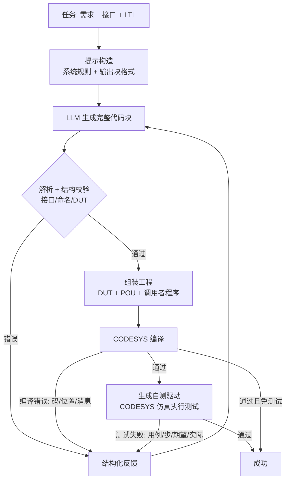

# 面向 CODESYS 平台的 ST 代码自动生成系统——实验报告

## 摘要

本工作实现了一个面向 CODESYS 平台的 ST（Structured Text）代码自动生成系统，包含
**数据与规约、自研轻量 Agent harness、CODESYS 编译服务、CODESYS 仿真行为测试、
统一评测管线**五部分，并在 30 道 PLC 编程题（20 道公共题 + 10 道自建题）上完成了
"现有框架（Codex CLI）× 自研 harness" 与 "DeepSeek × Qwen" 的四种实验设置对比。

主要结果（30 题、最多 5 轮编译反馈）：

| 设置 | 首次编译通过率 | 最终编译通过率 | 测试通过率 | 端到端成功率 | 平均轮次 | 平均耗时 |
|---|---|---|---|---|---|---|
| 自研 harness + DeepSeek | 96.7% | 100.0% | **83.3%** | 83.3% | 1.77 | 163 s |
| 自研 harness + Qwen | 76.7% | 93.3% | **66.7%** | 66.7% | 2.53 | 295 s |
| Codex CLI + DeepSeek | 100.0% | 100.0% | **83.3%** | 83.3% | 1.70 | 342 s |
| Codex CLI + Qwen | 16.7% | 53.3% | **33.3%** | 33.3% | 4.00 | 431 s |

结论：在 DeepSeek 下两框架测试通过率持平（83.3%），自研 harness 的 token 消耗约为
Codex 的 1/7、耗时约 1/2；在 Qwen 下自研 harness 明显更好（66.7% vs 33.3%）。
框架与模型的交互效应显著，详见第 5 节。

---

## 1. 实验环境

| 项 | 配置 |
|---|---|
| 操作系统 | Windows 11 Pro 10.0.26300 |
| PLC 开发环境 | CODESYS V3.5 SP22 Patch 4（x64），设备模板 Control Win V3 x64 |
| 标准库 | Standard 3.5.22.0（编译服务自动引用） |
| 运行时 | CODESYS 内置软 PLC 仿真（`set_simulation_mode` + OnlineApplication） |
| 脚本宿主 | CODESYS 内置 IronPython 2.7（worker）；客户端 CPython 3.12.5（仅标准库） |
| 模型网关 | DMXAPI（OpenAI 兼容，`https://www.dmxapi.cn/v1`；Responses 端点亦可用） |
| 模型 | DeepSeek `deepseek-v4.1-flash-1017`；Qwen `qwen3.7-flash` |
| 现有框架基线 | Codex CLI 0.164.0（`codex exec`，自定义 provider 指向 DMXAPI） |
| 采样参数 | 自研 harness：temperature 0.1，max_tokens 16384，重试 3 次；Codex 侧温度由框架默认控制 |
| 修复预算 | 两框架一致：最多 5 轮，同一反馈文本、同一编译/测试管线 |
| 超时 | LLM 调用 240 s（Codex 900 s）；编译批 300 s；单组仿真 600 s |
| 并发 | CODESYS 单实例串行（避免多实例冲突），实验逐题执行 |

**接入方式**

- 自研 harness 通过 OpenAI 兼容 Chat Completions 直连 DMXAPI；密钥仅存 `.env`
  （`.gitignore` 忽略，仓库只保留 `.env.example`）。
- Codex CLI 通过 `-c model_providers.dmxapi.*` 覆盖配置指向 DMXAPI，使用
  `wire_api="responses"`（0.164 已移除 chat 协议），`read-only` 沙箱、`--ephemeral`，
  仅取其最终消息作为生成结果。

**资源限制**

- 每题最多 5 轮修复；终止条件含"代码无变化"（stalled）与"失败签名连续重复"
  （no_progress），避免无效循环。
- 基础设施故障（模板/仿真/工具异常）记为 `tool_error`，**单列统计、不计入模型能力**；
  实验结束前已对全部 `tool_error` 重试至清零。

---

## 2. 数据集与形式化规约

### 2.1 构成

| 维度 | 数量 |
|---|---|
| 总题数 | 30（公共 20 + 自建 10） |
| 难度 | easy 9 / medium 12 / hard 9 |
| 形式化规约 | 75 条（平均 2.5 条/题） |
| 测试用例 | 54 组、199 个扫描步（每步均有测试目的，见 §2.6 与 `report/测试用例.md`） |

每题统一为 `FUNCTION_BLOCK` 接口（原公共题中的"程序类"题目改编为功能块，见 2.3），
配套：中英需求、结构化接口（输入/输出/输入输出/DUT）、LTL 规约、行为测试用例、
可编译且通过测试的参考实现。数据 schema 见 `dataset/schema.md`，**按作业模板整理的
逐题用例文档见 [`report/测试用例.md`](测试用例.md)**。

### 2.2 来源与改编记录

**公共题（20 道）**：来自课程提供的 `公共题库.json`（easy 6 / medium 8 / hard 6），
原始形式为英文需求 + 接口表。我们的加工：

1. 结构化接口（名称/类型/方向），补中文需求；
2. 逐题编写 LTL 规约与行为测试用例；
3. 编写参考实现并通过 CODESYS 编译 + 仿真测试；
4. 程序类题目（如"自动化生产线控制""柔性加工"）统一改为功能块接口，
   由测试驱动的调用者程序提供外部状态，保证可测性。

**自建题（10 道，3 easy / 4 medium / 3 hard）**：均为自主构思、结合常见 PLC 场景，
非外部题目搬运；每题在 `meta.scenario` 记录场景与考查点：

| 编号 | 题目 | 难度 | 场景/考查点 |
|---|---|---|---|
| self_easy_001 | 两相交通信号灯 | easy | 定时相位切换、绿灯互斥 |
| self_easy_002 | 水箱液位与高高报警 | easy | 滞环启停、超限报警 |
| self_easy_003 | 自动门控制 | easy | 状态机、保持延时、障碍重开 |
| self_medium_001 | 传送带高度分拣 | medium | 边沿触发、区间分类 |
| self_medium_002 | 主备泵交替运行 | medium | 边沿切换、反馈超时切泵 |
| self_medium_003 | 报警闭锁与确认复位 | medium | 闭锁/确认/复位优先级 |
| self_medium_004 | 星三角降压启动 | medium | 定时切换、接触器互锁 |
| self_hard_001 | 停车场车位计数 | hard | 双向边沿计数、容量约束 |
| self_hard_002 | 恒压供水多泵投切 | hard | 分级投切、死区 |
| self_hard_003 | 三层电梯控制 | hard | 目标楼层、到位检测、开门延时 |

**数据合理性**：自建题均对应真实 PLC 场景（交通、水务、门控、分拣、泵站、电机启动、
停车场、电梯），接口量级 2–8 个输入、1–6 个输出，与工业功能块规模一致；难度梯度
来自状态数量、定时/边沿语义和约束数量，而非人为堆砌。

### 2.3 关键改编

| 题目 | 原形式 | 改编 | 理由 |
|---|---|---|---|
| FIFO 队列（public_hard_006） | `VARIANT` 泛型 `buffer/item` | 元素固定 `INT` + `ARRAY[*]` 缓冲，容量由实参推导 | 当前 CODESYS 脚本工程不支持 `VARIANT`/`__VARCINFO`，改编后队列语义不变 |
| 程序类公共题（3 道） | `PROGRAM` 全局程序 | `FUNCTION_BLOCK` + 输入输出接口 | 统一测试与驱动方式，便于公平评测 |
| 模拟量批处理 | `ARRAY[*]` 变长数组 | 保留 `ARRAY[*]`，接口注明容量提示 | CODESYS 支持 `LOWER_BOUND/UPPER_BOUND`，无需改写 |

### 2.4 多样性

- **场景**：离散制造（分拣、生产线、机械臂）、流程工业（液位、配比、恒压供水）、
  电机控制（启停、星三角）、报警与安全（急停、闭锁、滞环）、计数与队列、字符串解析（IPv4）。
- **数据类型**：`BOOL/INT/DINT/UINT/USINT/WORD/DWORD/UDINT/REAL/LREAL/TIME/LTIME/
  STRING/ARRAY/ARRAY[*]/STRUCT/ENUM`；含 DUT 3 题、`VAR_IN_OUT` 4 题、`ARRAY[*]` 2 题。
- **语义特征**：边沿触发、定时器（TON/TOF）、状态机、互斥/优先级、边界与错误码。

### 2.5 形式化规约方法

每题用 LTL 描述安全性与功能性质，记法：`G`(always)、`F`(eventually)、`X`(next)，
逻辑 `! && || ->`。典型模式：

- 安全性：互斥 `G(!(A && B))`、急停优先 `G(!EStop -> !Motor)`；
- 功能：响应 `G(cond -> X(output))`、保持 `G(Start -> F(Run))`；
- 不变量：范围约束 `G(0 <= count && count <= capacity)`、单调性
  `G(count <= X(count))`；
- 错误处理：`G(badInput -> status = 16#8001)`。

规约同时用于：提示词中的行为约束、测试用例设计的可追溯依据。**未接入 PLCVerif**
（本阶段为选做加分项），规约未做机器验证，报告如实标注。

### 2.6 测试用例与数据集自检

- 执行语义：每个测试用例独立初始化被测功能块；逐步"设输入 → 执行一个扫描周期 →
  断言输出"；`repeat` 表示输入保持 N 个周期后在第 N 拍断言一次。
- **判定范围**：驱动只比较 `expect` 中列出的输出（及其结构体成员/数组元素），
  未列出的输出不做检查；因此 199 步中有 12 步（`public_easy_001`、
  `public_medium_005`、`public_hard_003`、`public_hard_004` 的状态等待步）不含断言，
  仅用于推进状态。这 4 道题的其余步骤都有显式断言。若要"未列出即 FALSE"的强语义，
  需要给这 12 步补全 `expect` 并重跑实验（见 §5.7 有效性威胁）。
- 定时器题按 `scan_ms` 设置任务周期，保证 TON/TOF 时间语义正确。
- **模板对齐**：作业文档「测试用例模板与示例」要求的用例级/步级说明以独立字段存放，
  由 `dataset/tc_annotations.py` 在构建时注入 `dataset/tasks/*.json`，`validate.py`
  强制非空：
  - `test_cases[].initialState`（初始状态）、`coverage`（覆盖内容）、
    `specRefs`（该用例提供证据的 LTL 规约 id，建立用例↔规约可追溯）；
  - `steps[].purpose`（每个扫描步的检查内容/测试目的，199/199 步齐全）。
- **用例文档**：`dataset/render_cases.py` 用参考实现在 CODESYS 仿真中**逐拍实测**
  所有输出（驱动内 `tr_*` 数组记录，仿真结束后按符号读回），渲染成
  `report/测试用例.md`：每题一节、每组用例一张模板表（周期 | 输入 | 预期输出 |
  实际输出 | 检查内容），题首列出四设置在该题的实测通过情况，并自动统计覆盖缺口
  （从未置 TRUE 的布尔输入、无断言步、未被任何用例引用的规约）。
  参考实现 31/31 次运行全部通过，表中"实际输出"即其逐拍实测值。
- **自检**：用参考实现跑自己的测试用例，要求 30/30 全通过。首轮自检发现 16 处问题
  （测试用例 off-by-one、边沿序列缺失、状态机未按序驱动、参考实现缺陷、驱动 inout
  未隔离等），修复后 **30/30 编译通过且测试通过**，确保数据集、测试与执行器相互印证。

### 2.7 逐题形式化规约

见 **附录 A**（30 题、75 条规约全文）。

---

## 3. 自研 PLC 代码生成 Agent 框架设计

### 3.1 总体架构



### 3.2 模块与职责

| 模块 | 职责 |
|---|---|
| `agent/llm.py` | OpenAI 兼容客户端（DMXAPI）；token 统计、重试、`.env` 加载；MockClient 离线回放 |
| `agent/prompt.py` | 系统规则（CODESYS 编译约束/输出块格式）、题目提示、三类反馈模板 |
| `agent/parser.py` | 块格式解析；无标记纯 ST 回退解析；接口/命名/DUT 静态校验 |
| `agent/caller_gen.py` | 生成 `PLC_PRG` 调用者，保证 `VAR_IN_OUT`/结构体参数被真实编译 |
| `agent/harness.py` | 主循环、终止条件、逐题记录 |
| `tool/` | CODESYS 编译服务（模板工程、DUT/Standard 库、结构化诊断） |
| `tester/` | 自测驱动生成 + CODESYS 仿真执行 + 实际值快照 |
| `experiments/` | 批量评测、mock、汇总与 2×2 对比 |

### 3.3 任务组织

单 Agent 主循环：一次生成完整工程（DUT + 目标 POU），每轮根据编译/测试反馈整体重写。
任务理解通过结构化提示完成：需求（中/英）、接口表、LTL、POU 名称与类型，
避免让模型猜测接口。

### 3.4 上下文管理

- `system + 题目` 常驻；历史只保留最近 2 轮对话，降低重复输入；
- 编译错误按 `(code, text)` 去重并计数，避免同类错误刷屏；
- 测试反馈只给首个失败用例/步骤与标量实际值（快照），控制篇幅；
- 记录每轮原始输出（截断）用于复盘，但不回灌给模型。

### 3.5 工具调用

- **编译**：一个作业一次 CODESYS 冷启动；模板工程 + DUT 注入 + Standard 库 +
  `auto_wire=false` + 自动生成调用者（标量传字面量，数组/结构体传变量），
  保证所有 POU 真正进入编译图（解决 CODESYS "只编译任务可达调用图" 的假阴性）。
- **测试**：测试用例编译为 ST 自测驱动（在 PLC 内逐拍施加输入并断言），
  通过在线 API 读取结果；失败步的标量输出被快照并回传。
- **结构校验前置**：接口/命名/DUT 非法时直接反馈，不消耗 CODESYS 冷启动。

### 3.6 编译与修复

反馈内容 = 错误码 + 行列位置 + 中文消息（如 `C46 行2,列1: 没有定义标识符'x'`）；
若输出被截断（`finish_reason=length`）提示精简；若模型原样重复代码或连续两次相同
失败签名则提前终止。

### 3.7 终止条件

① 编译+测试通过；② 达到 5 轮；③ 代码与上一轮完全一致（stalled）；
④ 失败签名连续 2 次相同（no_progress）；⑤ 工具故障（tool_error 单列）。
据此避免无效循环，同时记录终止原因用于分析。

### 3.8 行为测试

- 基于 **CODESYS 官方仿真运行时**（Control Win V3），语义与编译器一致，
  不存在"自研解释器不支持某语法"的问题；
- 每轮模型代码都在同一模板/同一 worker/同一仿真配置下评测；
- 测试用例**对模型不可见**（提示只给需求/接口/LTL），避免评测泄漏；
- 驱动为每个测试用例分配独立功能块实例（实例数组），保证用例间状态隔离；
  inout 存储同样按用例隔离；`ARRAY[*]` 由容量提示实例化。

### 3.9 设计依据

- 编译是硬门槛、测试是正确性门槛：两阶段反馈分别对应"能编译"与"行为对"；
- 结构化、去重的反馈比原始日志更利于模型定位问题，且显著降低 token；
- 预校验把格式/接口错误挡在 CODESYS 之外，节省冷启动时间；
- 终止启发式兼顾质量与成本，防止模型陷入循环。

---

## 4. 实验设置

### 4.1 四种设置

| | DeepSeek | Qwen |
|---|---|---|
| 现有框架（Codex CLI） | 实验 1 | 实验 2 |
| 自研 harness | 实验 3 | 实验 4 |

全部设置覆盖全部 30 题，每题最多 5 轮，记录每轮代码/编译/测试/用量/耗时。

### 4.2 基线适配与公平性

- Codex CLI 被包装为与自研 harness 相同的 `chat(messages)` 客户端，因此
  **提示文本、反馈文本、轮次上限、编译与测试管线完全一致**；差异只在生成组织方式
  （Codex 自带 agent 循环与工具上下文）。
- Codex 在新鲜空目录、`read-only` 沙箱中运行，只取最终消息；其工具调用开销计入
  token 与耗时，属于框架本身成本。
- 两框架使用同一 DMXAPI 网关、同一模型快照、同一 CODESYS 模板与 worker 版本。

### 4.3 指标定义

- **首次编译通过率**：第 1 轮提交即编译通过（格式/接口错误未进入编译按未通过计）。
- **最终编译通过率**：最后一次生成代码编译通过。
- **测试通过率**：行为测试全部通过的任务比例（端到端成功）。
- **资源**：输入/输出 token、墙钟时间、平均修复轮次。
- `tool_error` 单列，不计入模型能力；本报告全部设置已重试至 0。

### 4.4 复现

```bash
python dataset/check_references.py         # 参考实现编译自检
python tester/run_all.py                   # 参考实现行为自检（30/30）
python experiments/run_eval.py --models deepseek,qwen --max-rounds 5 \
    --resume --outdir experiments/runs/agent_2models
python experiments/run_eval.py --framework codex --models deepseek,qwen \
    --max-rounds 5 --resume --outdir experiments/runs/codex_2models
python experiments/summarize.py experiments/runs/agent_2models \
    experiments/runs/codex_2models --out experiments/RESULTS_FULL.md
```

---

## 5. 实验结果与分析

### 5.1 总体结果

| 框架 | 模型 | 首次编译 | 最终编译 | 测试通过 | 平均轮次 | 平均耗时(s) | 输入 tokens | 输出 tokens |
|---|---|---|---|---|---|---|---|---|
| 自研 harness | deepseek-v4.1-flash-1017 | 96.7% | 100.0% | 83.3% | 1.77 | 163 | 75,058 | 383,312 |
| 自研 harness | qwen3.7-flash | 76.7% | 93.3% | 66.7% | 2.53 | 295 | 131,255 | 503,606 |
| Codex CLI | deepseek-v4.1-flash-1017 | 100.0% | 100.0% | 83.3% | 1.70 | 342 | 565,110 | 521,147 |
| Codex CLI | qwen3.7-flash | 16.7% | 53.3% | 33.3% | 4.00 | 431 | 1,632,869 | 358,524 |

**观察**

1. **DeepSeek 下两框架最终测试通过率相同（83.3%）**。Codex 首轮编译更高
   （100% vs 96.7%），自研的平均轮次略多（1.77 vs 1.70），说明自研的接口预校验
   与回退解析并未牺牲最终质量。
2. **资源差异显著**：自研 harness 输入 token 仅为 Codex 的 **13%**（75k vs 565k），
   耗时约 **48%**（163s vs 342s）。Codex 的 agent 循环（工具、系统提示、上下文累积）
   带来大量额外输入；这属于"现有框架"的真实成本特征。
3. **Qwen 下自研明显优于 Codex**（66.7% vs 33.3%）：同一模型经 Codex 时首轮编译仅
   16.7%，大量语法/接口错误，且 5 轮内仅修复部分（最终编译 53.3%）。

### 5.2 分难度（测试通过率）

| 框架 | 模型 | easy (9) | medium (12) | hard (9) |
|---|---|---|---|---|
| 自研 | DeepSeek | 77.8% | 91.7% | 77.8% |
| 自研 | Qwen | 55.6% | 83.3% | 55.6% |
| Codex | DeepSeek | 88.9% | 83.3% | 77.8% |
| Codex | Qwen | 55.6% | 16.7% | 33.3% |

- 两框架在 hard 上的差距不大（DeepSeek 均 77.8%），说明困难点主要在**行为语义**
  （状态机、定时/边沿），编译反馈难以完全解决；
- Codex+Qwen 在 medium 异常低（16.7%），主要由于首轮普遍编译失败、轮次耗尽。

### 5.3 修复轮次分布

| 设置 | 1 轮 | 2 轮 | 3 轮 | 4 轮 | 5 轮 | 平均 |
|---|---|---|---|---|---|---|
| 自研+DeepSeek | 20 | 2 | 5 | 1 | 2 | 1.77 |
| 自研+Qwen | 13 | 3 | 6 | 1 | 7 | 2.53 |
| Codex+DeepSeek | 21 | 1 | 6 | 0 | 2 | 1.70 |
| Codex+Qwen | 1 | 5 | 5 | 1 | 18 | 4.00 |

DeepSeek 多数题 1 轮通过；Qwen 经 Codex 时 18/30 题耗尽 5 轮，修复效率低。

### 5.4 错误分布

按失败阶段（成功 / 编译未通过 / 测试未通过）：

| 设置 | 成功 | 编译未通过 | 测试未通过 |
|---|---|---|---|
| 自研+DeepSeek | 25 | 0 | 5 |
| 自研+Qwen | 20 | 2 | 8 |
| Codex+DeepSeek | 25 | 0 | 5 |
| Codex+Qwen | 10 | 14 | 6 |

编译错误码统计（所有轮次累计）：

- 自研+DeepSeek：`C189` 14、`C9` 13（语句结构/缺少分隔符），少量 `C20/C22`；
- 自研+Qwen：`C189` 34、`C9` 20、`C32` 12（类型转换，如 TIME/LTIME/ULINT）、
  `C46` 5（未定义标识符）、`C77` 4（未知类型）；
- Codex+DeepSeek：无编译错误（首轮全部通过）；
- Codex+Qwen：`C6` 140（运算符/分隔符不合法，如把 `:=` 写成 `=`、使用 `!`）、
  `C189` 95、`C9` 80、`C32` 43、`C135` 41（编译器不支持的操作）。

Qwen 的典型错误为：非 IEC 语法（`!`、C 风格表达式）、遗漏 `VAR_IN_OUT` 参数、
非法 DUT（如 `kind=dword`、DUT 与 POU 同名）、`ENUM` 块写法不符合 CODESYS。

### 5.5 失败案例分析

- **行为失败（两框架共同）**：状态机题（五工位生产、柔性加工）与定时/边沿题
  （焊缝去抖、自动门、交通灯）常出现"差一拍"或未覆盖优先级；
- **修复终止**：连续相同失败签名或代码不再变化时提前停止（如 `stalled`），
  这类题最终未通过，但节省了无效轮次；
- **工具问题已消除**：实验过程中修复了 DUT 校验、POU 命名冲突、输出截断提示、
  Codex UTF-8 stdin 等问题，最终 `tool_error = 0`。

### 5.6 框架×模型交互

DeepSeek 对两种框架都稳定（83.3%）；Qwen 对框架敏感：自研的"结构化单轮重写 +
显式接口校验 + 块格式"更适配其输出习惯，而 Codex 的通用 agent 提示/工具上下文
使其产生更多 IEC 语法偏差。说明**框架与模型需要匹配调优**，不能简单假设
"更强的 agent 框架对任意模型都更好"。

### 5.7 有效性威胁

- 每题仅采样 1 次（temperature 0.1），未做多次重复，存在采样方差；
- LTL 规约未机器验证，测试用例覆盖有限，可能漏检行为缺陷；
- **判定强度**：驱动只断言 `expect` 中列出的输出，12 个扫描步不含断言（§2.6）；
  34 个布尔输入从未被置为 TRUE，分布在 9 道题（`public_hard_001`–`005`、
  `public_medium_002`、`public_medium_006`、`self_easy_003`、`self_medium_004`；
  逐题清单见 `report/测试用例.md` 题首的「已知覆盖缺口」）。
  因此报告的测试通过率是"在现有用例下"的通过率，严格化用例后可能下降；
- Codex 温度/系统提示由框架默认控制，与自研不完全等价（已在 4.2 说明）；
- CODESYS 编译器版本与设备模板固定，结论对其他 PLC 平台需重新验证；
- 成本未折算货币（DMXAPI 定价未配置），仅比较 token 与时间。

---

## 6. 加分项完成情况

| 项 | 状态 |
|---|---|
| 自动测试 | ✅ 已集成：CODESYS 仿真自动执行全部测试用例并回传实际值 |
| 形式化验证（PLCVerif） | ⏸ 规约已逐题编写，工具接入留待后续（本阶段未做） |
| 多平台接入（TIA Portal） | ⏸ 未做 |

---

## 7. 结论

1. 构建了 30 题（20 公共 + 10 自建）的 ST 生成数据集，逐题具备 LTL 规约、测试用例与
   可编译参考实现；参考实现 30/30 通过 CODESYS 编译与仿真测试，形成可复现的质量基线。
2. 自研 harness 通过"接口预校验 → CODESYS 编译 → 仿真行为测试 → 结构化反馈"的
   轻量循环，在 DeepSeek 下达到与 Codex CLI 相同的测试通过率（83.3%），
   同时输入 token 约为后者的 1/7、耗时约 1/2；在 Qwen 下显著优于基线
   （66.7% vs 33.3%）。
3. 失败主要集中在行为层面（状态机、定时/边沿）而非编译层面，说明编译反馈已能解决
   "能编译"，下一步价值在于更强的行为规约/验证（如 PLCVerif）与测试覆盖。

---

## 附录 A 逐题形式化规约

| 编号 | 题目 | 难度 | 来源 | POU | LTL 规约 |
| --- | --- | --- | --- | --- | --- |
| public_easy_001 | 自动灌装线控制 | easy | 公共 | `FillingLine` | **P1**: `G(!(Pump_Motor && Filling_Valve) && !(Filling_Valve && Capping_Machine) && !(Capping_Machine && Packing_Machine) && !(Packing_Machine && Completion_Light))`<br>**P2**: `G(bottleSensor -> X(Pump_Motor))`<br>**P3**: `G((Pump_Motor && cleaningConfirmButton) -> X(Filling_Valve))`<br>**P4**: `G((Packing_Machine && packingConfirmButton) -> X(Completion_Light))`<br>**P5**: `G((Completion_Light && finishedButton) -> X(!Completion_Light))` |
| public_easy_002 | 双字边沿检测 | easy | 公共 | `EdgeDetect` | **P1**: `G(hasChanged -> (risingBits <> 0 || fallingBits <> 0))`<br>**P2**: `G((risingBits <> 0) <-> hasRisingEdges)`<br>**P3**: `G((fallingBits <> 0) <-> hasFallingEdges)`<br>**P4**: `G((risingBits AND fallingBits) = 0)` |
| public_easy_003 | 带滞环的报警处理 | easy | 公共 | `AlarmHyst` | **P1**: `G((!error && Value > hiLevel) -> hiAlarm)`<br>**P2**: `G((!error && Value < hiLevel - hystWindow) -> !hiAlarm)`<br>**P3**: `G((!error && Value < loLevel) -> loAlarm)`<br>**P4**: `G((!error && Value > loLevel + hystWindow) -> !loAlarm)`<br>**P5**: `G((loLevel >= hiLevel) -> error)` |
| public_easy_004 | 果酱泵去抖与运行维护 | easy | 公共 | `JamPump` | **P1**: `G(!PASTE_E_STOP_NC -> !VFD_RUN)`<br>**P2**: `G(!VISCOSITY_OK -> X(!VFD_RUN))`<br>**P3**: `G(PUMP_RUNTIME_ACC <= X(PUMP_RUNTIME_ACC))` |
| public_easy_005 | 焊缝间隙报警与启动抑制 | easy | 公共 | `WeldGap` | **P1**: `G(!Weld_E_Stop_NC -> !Operator_Alert)`<br>**P2**: `G(Weld_Soft_Start_Active -> !Operator_Alert)`<br>**P3**: `G(Operator_Alert -> Gap_Exceeded)`<br>**P4**: `G(F(!Weld_Soft_Start_Active))` |
| public_easy_006 | 曝气风机延时启动 | easy | 公共 | `AerationBlower` | **P1**: `G(!AERATION_E_STOP_NC -> !BLOWER_RUN)`<br>**P2**: `G(BLOWER_RUN -> DO_LOW)`<br>**P3**: `G(AERATION_BLOWER_CYCLE_COUNT <= X(AERATION_BLOWER_CYCLE_COUNT))` |
| self_easy_001 | 两相交通信号灯 | easy | 自建 | `TrafficLight` | **P1**: `G(!(NS_Green && EW_Green))`<br>**P2**: `G(NS_Green || EW_Green)` |
| self_easy_002 | 水箱液位控制与高高报警 | easy | 自建 | `TankLevel` | **P1**: `G(level > highHighLevel -> highHighAlarm)`<br>**P2**: `G(level < lowLevel -> pumpOn)` |
| self_easy_003 | 自动门控制 | easy | 自建 | `AutoDoor` | **P1**: `G(!(openCmd && closeCmd))`<br>**P2**: `G(presence -> openCmd)` |
| public_medium_001 | 多泵轮换供水控制 | medium | 公共 | `MultiPump` | **P1**: `G(stop -> !pumpGroup[1].RunComd)`<br>**P2**: `G((!mode && !stop && start && pumpGroup[1].selection) -> pumpGroup[1].RunComd)`<br>**P3**: `G((!mode && !stop && start && !pumpGroup[1].selection) -> !pumpGroup[1].RunComd)` |
| public_medium_002 | 移动平均计算 | medium | 公共 | `MovingAverage` | **P1**: `G((windowSize < 1 || windowSize > 100) -> error)`<br>**P2**: `G(!error -> status = 0)` |
| public_medium_003 | 温度控制逻辑 | medium | 公共 | `TempControl` | **P1**: `G((TemperatureSensorInput < 0 || TemperatureSensorInput > 100) -> !HeaterOutput)`<br>**P2**: `G((TemperatureSensorInput < SetTemperature && !OverheatProtection) -> HeaterOutput)`<br>**P3**: `G(OverheatProtection -> !HeaterOutput)` |
| public_medium_004 | 模拟量批处理转换 | medium | 公共 | `AnalogBatch` | **P1**: `G((channels[0].enable && (channels[0].measuringMode < 0 || channels[0].measuringMode > 2)) -> channels[0].retVal = 16#8001)`<br>**P2**: `G((channels[0].enable && channels[0].hiLIM <= channels[0].loLIM) -> channels[0].retVal = 16#8002)` |
| public_medium_005 | 自动化生产线控制 | medium | 公共 | `ProductionLine` | **P1**: `G(!(MotorForward && MotorReverse))`<br>**P2**: `G((!Mode && ForwardButton && !ReverseButton) -> MotorForward)`<br>**P3**: `G(CompletionLight -> SensorC)` |
| public_medium_006 | 板厚报警与故障历史 | medium | 公共 | `SlabThickness` | **P1**: `G(!THICKNESS_SIGNAL_VALID -> !THICKNESS_ALARM)`<br>**P2**: `G(THICKNESS_ALARM -> THICKNESS_SIGNAL_VALID)`<br>**P3**: `G(Slab_Fault_Counter <= X(Slab_Fault_Counter))` |
| public_medium_007 | 办公楼 HVAC 多模式节能控制 | medium | 公共 | `HVAC` | **P1**: `G(HVAC_MODE_SELECTOR = 3 -> !SUPPLY_FAN_RUN)`<br>**P2**: `G(TEMP_SETPOINT_ADJUST >= -4 && TEMP_SETPOINT_ADJUST <= 4)`<br>**P3**: `G((HVAC_MODE_SELECTOR = 0 && !OCCUPANCY_DETECTED && ENERGY_SAVING_MODE) -> TEMP_SETPOINT_ADJUST = 3)` |
| public_medium_008 | IPv4 地址解析 | medium | 公共 | `IPv4Parse` | **P1**: `G(ipValue <= 16#FFFFFFFF)` |
| self_medium_001 | 传送带高度分拣 | medium | 自建 | `HeightSort` | **P1**: `G(binSel >= 1 && binSel <= 3)` |
| self_medium_002 | 主备泵交替运行 | medium | 自建 | `PumpAlternation` | **P1**: `G(stop -> (!pump1Run && !pump2Run))`<br>**P2**: `G(!(pump1Run && pump2Run))` |
| self_medium_003 | 报警闭锁与确认复位 | medium | 自建 | `AlarmLatch` | **P1**: `G(acknowledge -> !horn)`<br>**P2**: `G(reset -> !alarmLatched)` |
| self_medium_004 | 星三角降压启动 | medium | 自建 | `StarDelta` | **P1**: `G(!(starContactor && deltaContactor))`<br>**P2**: `G(overload -> (!mainContactor && !starContactor && !deltaContactor))` |
| public_hard_001 | 配方管理系统 | hard | 公共 | `RecipeMgmt` | **P1**: `G(!error -> status = 0)`<br>**P2**: `G(error -> (status = 16#8001 || status = 16#8002 || status = 16#8003 || status = 16#8004 || status = 16#8005))` |
| public_hard_002 | 物料配比过程控制 | hard | 公共 | `MaterialMix` | **P1**: `G(!estop -> (!valveARun && !valveBRun && !valveCRun && !valveDRun && !mixMotorRun))`<br>**P2**: `G((!opeMode && estop && valveAStart && !X(valveAStart)) -> (valveARun <-> !X(valveARun)))` |
| public_hard_003 | 五工位生产控制 | hard | 公共 | `ProductionControl` | **P1**: `G(!(MotorForward && MotorReverse))`<br>**P2**: `G(CompletionLight -> SensorOutput)`<br>**P3**: `G(firingTemp >= 500.0 && firingTemp <= 550.0)` |
| public_hard_004 | 柔性加工控制 | hard | 公共 | `FlexProcess` | **P1**: `G(!(conveyorLeft && conveyorRight))`<br>**P2**: `G((sensor1 && station1Start) -> F(sensor5))` |
| public_hard_005 | 机械臂控制 | hard | 公共 | `MechArm` | **P1**: `G(!EmergencyStop -> (!MoveDown && !MoveUp && !MoveLeft && !MoveRight && !ActivateGrip && !ActivateRelease))` |
| public_hard_006 | FIFO 先进先出队列 | hard | 公共 | `FifoQueue` | **P1**: `G(elementCount >= 0 && elementCount <= 10)`<br>**P2**: `G((reset || elementCount = 0) -> (status = 0 || status = 16#8001))` |
| self_hard_001 | 停车场车位计数 | hard | 自建 | `ParkingLot` | **P1**: `G(count >= 0 && count <= capacity)`<br>**P2**: `G(count >= capacity -> !entryGate)` |
| self_hard_002 | 恒压供水多泵投切 | hard | 自建 | `ConstPressure` | **P1**: `G(pressure < setpoint - deadband -> (pump1Run || pump2Run || pump3Run))`<br>**P2**: `G(pressure > setpoint + deadband -> (!pump1Run && !pump2Run && !pump3Run))` |
| self_hard_003 | 三层电梯控制 | hard | 自建 | `Elevator` | **P1**: `G(!(motorUp && motorDown))`<br>**P2**: `G(doorOpen -> (!motorUp && !motorDown))` |

## 附录 B 未成功任务明细

| 设置 | 任务 | 难度 | 终止状态 | 轮次 | 卡点 |
| --- | --- | --- | --- | --- | --- |
| 自研+Qwen | public_easy_004 | easy | max_rounds | 5 | 测试未通过 |
| Codex+Qwen | public_easy_004 | easy | no_progress | 5 | 编译未通过 |
| 自研+DeepSeek | public_easy_005 | easy | max_rounds | 5 | 测试未通过 |
| 自研+Qwen | public_easy_005 | easy | no_progress | 3 | 测试未通过 |
| Codex+Qwen | public_easy_005 | easy | no_progress | 4 | 测试未通过 |
| 自研+Qwen | self_easy_001 | easy | max_rounds | 5 | 测试未通过 |
| Codex+Qwen | self_easy_001 | easy | max_rounds | 5 | 编译未通过 |
| 自研+DeepSeek | self_easy_003 | easy | no_progress | 3 | 测试未通过 |
| 自研+Qwen | self_easy_003 | easy | no_progress | 3 | 测试未通过 |
| Codex+DeepSeek | self_easy_003 | easy | no_progress | 3 | 测试未通过 |
| Codex+Qwen | self_easy_003 | easy | max_rounds | 5 | 编译未通过 |
| Codex+Qwen | public_medium_001 | medium | max_rounds | 5 | 测试未通过 |
| Codex+Qwen | public_medium_002 | medium | max_rounds | 5 | 编译未通过 |
| 自研+Qwen | public_medium_003 | medium | no_progress | 3 | 测试未通过 |
| Codex+DeepSeek | public_medium_003 | medium | max_rounds | 5 | 测试未通过 |
| Codex+Qwen | public_medium_003 | medium | max_rounds | 5 | 编译未通过 |
| 自研+Qwen | public_medium_004 | medium | max_rounds | 5 | 编译未通过 |
| Codex+Qwen | public_medium_004 | medium | max_rounds | 5 | 测试未通过 |
| 自研+DeepSeek | public_medium_005 | medium | stalled | 4 | 测试未通过 |
| Codex+DeepSeek | public_medium_005 | medium | no_progress | 3 | 测试未通过 |
| Codex+Qwen | public_medium_005 | medium | max_rounds | 5 | 编译未通过 |
| Codex+Qwen | public_medium_006 | medium | max_rounds | 5 | 编译未通过 |
| Codex+Qwen | public_medium_007 | medium | max_rounds | 5 | 编译未通过 |
| Codex+Qwen | public_medium_008 | medium | max_rounds | 5 | 编译未通过 |
| Codex+Qwen | self_medium_002 | medium | no_progress | 5 | 测试未通过 |
| Codex+Qwen | self_medium_004 | medium | no_progress | 3 | 测试未通过 |
| Codex+Qwen | public_hard_001 | hard | max_rounds | 5 | 编译未通过 |
| Codex+Qwen | public_hard_002 | hard | max_rounds | 5 | 测试未通过 |
| 自研+DeepSeek | public_hard_003 | hard | no_progress | 3 | 测试未通过 |
| 自研+Qwen | public_hard_003 | hard | no_progress | 3 | 测试未通过 |
| Codex+DeepSeek | public_hard_003 | hard | no_progress | 3 | 测试未通过 |
| Codex+Qwen | public_hard_003 | hard | max_rounds | 5 | 编译未通过 |
| 自研+DeepSeek | public_hard_004 | hard | no_progress | 3 | 测试未通过 |
| 自研+Qwen | public_hard_004 | hard | no_progress | 5 | 测试未通过 |
| Codex+DeepSeek | public_hard_004 | hard | no_progress | 3 | 测试未通过 |
| Codex+Qwen | public_hard_004 | hard | max_rounds | 5 | 编译未通过 |
| 自研+Qwen | public_hard_006 | hard | max_rounds | 5 | 编译未通过 |
| Codex+Qwen | public_hard_006 | hard | max_rounds | 5 | 编译未通过 |
| 自研+Qwen | self_hard_003 | hard | max_rounds | 5 | 测试未通过 |
| Codex+Qwen | self_hard_003 | hard | max_rounds | 5 | 编译未通过 |

## 附录 C 逐题四设置结果（测试是否全部通过）

| 任务 | 难度 | 题目 | 自研+DeepSeek | 自研+Qwen | Codex+DeepSeek | Codex+Qwen |
| --- | --- | --- | --- | --- | --- | --- |
| public_easy_001 | easy | 自动灌装线控制 | ✓ | ✓ | ✓ | ✓ |
| public_easy_002 | easy | 双字边沿检测 | ✓ | ✓ | ✓ | ✓ |
| public_easy_003 | easy | 带滞环的报警处理 | ✓ | ✓ | ✓ | ✓ |
| public_easy_004 | easy | 果酱泵去抖与运行维护 | ✓ | ✗ | ✓ | ✗ |
| public_easy_005 | easy | 焊缝间隙报警与启动抑制 | ✗ | ✗ | ✓ | ✗ |
| public_easy_006 | easy | 曝气风机延时启动 | ✓ | ✓ | ✓ | ✓ |
| self_easy_001 | easy | 两相交通信号灯 | ✓ | ✗ | ✓ | ✗ |
| self_easy_002 | easy | 水箱液位控制与高高报警 | ✓ | ✓ | ✓ | ✓ |
| self_easy_003 | easy | 自动门控制 | ✗ | ✗ | ✗ | ✗ |
| public_medium_001 | medium | 多泵轮换供水控制 | ✓ | ✓ | ✓ | ✗ |
| public_medium_002 | medium | 移动平均计算 | ✓ | ✓ | ✓ | ✗ |
| public_medium_003 | medium | 温度控制逻辑 | ✓ | ✗ | ✗ | ✗ |
| public_medium_004 | medium | 模拟量批处理转换 | ✓ | ✗ | ✓ | ✗ |
| public_medium_005 | medium | 自动化生产线控制 | ✗ | ✓ | ✗ | ✗ |
| public_medium_006 | medium | 板厚报警与故障历史 | ✓ | ✓ | ✓ | ✗ |
| public_medium_007 | medium | 办公楼 HVAC 多模式节能控制 | ✓ | ✓ | ✓ | ✗ |
| public_medium_008 | medium | IPv4 地址解析 | ✓ | ✓ | ✓ | ✗ |
| self_medium_001 | medium | 传送带高度分拣 | ✓ | ✓ | ✓ | ✓ |
| self_medium_002 | medium | 主备泵交替运行 | ✓ | ✓ | ✓ | ✗ |
| self_medium_003 | medium | 报警闭锁与确认复位 | ✓ | ✓ | ✓ | ✓ |
| self_medium_004 | medium | 星三角降压启动 | ✓ | ✓ | ✓ | ✗ |
| public_hard_001 | hard | 配方管理系统 | ✓ | ✓ | ✓ | ✗ |
| public_hard_002 | hard | 物料配比过程控制 | ✓ | ✓ | ✓ | ✗ |
| public_hard_003 | hard | 五工位生产控制 | ✗ | ✗ | ✗ | ✗ |
| public_hard_004 | hard | 柔性加工控制 | ✗ | ✗ | ✗ | ✗ |
| public_hard_005 | hard | 机械臂控制 | ✓ | ✓ | ✓ | ✓ |
| public_hard_006 | hard | FIFO 先进先出队列 | ✓ | ✗ | ✓ | ✗ |
| self_hard_001 | hard | 停车场车位计数 | ✓ | ✓ | ✓ | ✓ |
| self_hard_002 | hard | 恒压供水多泵投切 | ✓ | ✓ | ✓ | ✓ |
| self_hard_003 | hard | 三层电梯控制 | ✓ | ✗ | ✓ | ✗ |

图例：✓ 测试全部通过；✗ 未通过；T 工具错误（均已清零）。

## 附录 D 仓库结构与复现

| 目录/文件 | 说明 |
|---|---|
| `dataset/` | 30 题 JSON、schema、校验与参考实现编译自检脚本；`tc_annotations.py` 存放用例级/步级说明文字，`render_cases.py` 渲染测试用例文档 |
| `tool/` | CODESYS 编译服务（CPython 客户端 + IronPython worker + 模板工程） |
| `tester/` | 自测驱动生成 + CODESYS 仿真执行（支持逐拍 `trace=True` 记录实测输出） |
| `agent/` | 自研 ST 生成 Agent harness |
| `baseline/` | Codex CLI 基线适配 |
| `experiments/` | 批量评测、mock、汇总；`RESULTS_FULL.md` 为四设置汇总 |
| `report/` | 本报告 + `测试用例.md`（按作业模板渲染的 54 组用例） |

复现命令见 4.4；运行产物（`experiments/runs/`、`tool/work/`、`tester/work/`、
`dataset/.cache/`）已被 `.gitignore` 排除。`report/测试用例.md` 由
`python dataset/render_cases.py` 重新生成（会实际跑一遍参考实现的仿真）。
