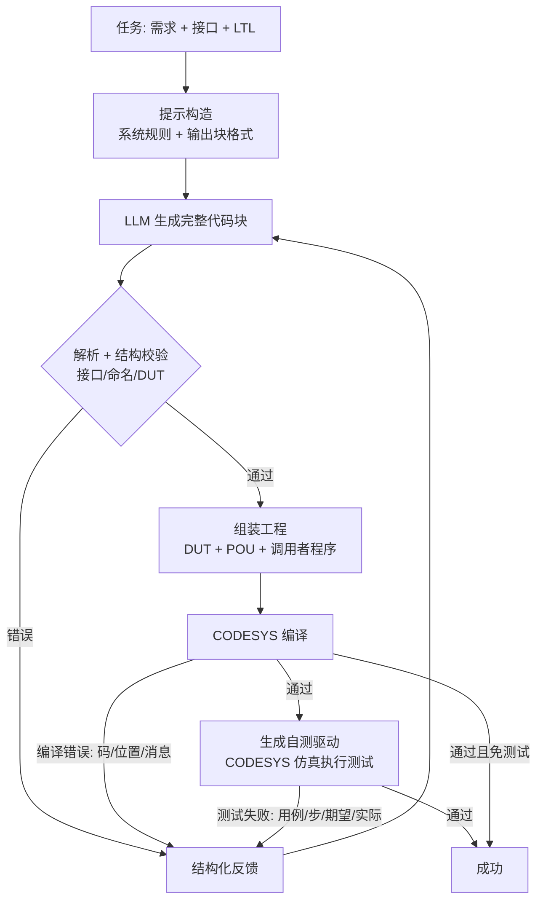

# 面向 CODESYS 平台的 ST 代码自动生成系统——实验报告

> 英文版：[`Report_EN.md`](Report_EN.md)（正文）与 [`Appendix_EN.md`](Appendix_EN.md)（附录）。

## 摘要

本工作实现了一个面向 CODESYS 平台的 ST（Structured Text）代码自动生成系统，包含
**数据与规约、自研轻量 Agent harness、CODESYS 编译服务、CODESYS 仿真行为测试、
统一评测管线**五部分，并在 30 道 PLC 编程题（20 道公共题 + 10 道自建题）上完成了
"现有框架（Codex CLI）× 自研 harness" 与 "DeepSeek × Qwen" 的四种实验设置对比。

主要结果（30 题、最多 5 轮编译反馈）：

| 设置 | 首次编译通过率 | 最终编译通过率 | 测试通过率 | 端到端成功率 | 平均轮次 | 平均耗时 |
|---|---|---|---|---|---|---|
| 自研 harness + DeepSeek | 96.7% | 100.0% | **83.3%** | 83.3% | 1.77 | 163 s |
| 自研 harness + Qwen | 76.7% | 93.3% | **66.7%** | 66.7% | 2.53 | 295 s |
| Codex CLI + DeepSeek | 100.0% | 100.0% | **83.3%** | 83.3% | 1.70 | 342 s |
| Codex CLI + Qwen | 30.0% | 83.3% | **46.7%** | 46.7% | 3.53 | 315 s |

结论：在 DeepSeek 下两框架测试通过率持平（83.3%），自研 harness 的 token 消耗约为
Codex 的 1/7、耗时约 1/2；在 Qwen 下自研 harness 仍明显更好（66.7% vs 46.7%）。
框架与模型的交互效应显著，详见第 5 节。

---

## 1. 实验环境

| 项 | 配置 |
|---|---|
| 操作系统 | Windows 11 Pro 10.0.26300 |
| PLC 开发环境 | CODESYS V3.5 SP22 Patch 4（x64），设备模板 Control Win V3 x64 |
| 标准库 | Standard 3.5.22.0（编译服务自动引用） |
| 运行时 | CODESYS 内置软 PLC 仿真（`set_simulation_mode` + OnlineApplication） |
| 脚本宿主 | CODESYS 内置 IronPython 2.7（worker）；客户端 CPython 3.12.5（仅标准库） |
| 模型网关 | DMXAPI（OpenAI 兼容，`https://www.dmxapi.cn/v1`；Responses 端点亦可用） |
| 模型 | DeepSeek `deepseek-v4.1-flash-1017`；Qwen `qwen3.7-flash` |
| 现有框架基线 | Codex CLI 0.164.0（`codex exec`，自定义 provider 指向 DMXAPI） |
| 采样参数 | 自研 harness：temperature 0.1，max_tokens 16384，重试 3 次；Codex 侧温度由框架默认控制 |
| 修复预算 | 两框架一致：最多 5 轮，同一反馈文本、同一编译/测试管线 |
| 超时 | LLM 调用 240 s（Codex 900 s）；编译批 300 s；单组仿真 600 s |
| 并发 | CODESYS 单实例串行（避免多实例冲突），实验逐题执行 |

**接入方式**

- 自研 harness 通过 OpenAI 兼容 Chat Completions 直连 DMXAPI；密钥仅存 `.env`
  （`.gitignore` 忽略，仓库只保留 `.env.example`）。
- Codex CLI 通过 `-c model_providers.dmxapi.*` 覆盖配置指向 DMXAPI，使用
  `wire_api="responses"`（0.164 已移除 chat 协议），`read-only` 沙箱、`--ephemeral`，
  仅取其最终消息作为生成结果。

**资源限制**

- 每题最多 5 轮修复；终止条件含"代码无变化"（stalled）与"失败签名连续重复"
  （no_progress），避免无效循环。
- 基础设施故障（模板/仿真/工具异常）记为 `tool_error`，**单列统计、不计入模型能力**；
  实验结束前已对全部 `tool_error` 重试至清零。

---

## 2. 数据集与形式化规约

### 2.1 构成

| 维度 | 数量 |
|---|---|
| 总题数 | 30（公共 20 + 自建 10） |
| 难度 | easy 9 / medium 12 / hard 9 |
| 形式化规约 | 75 条（平均 2.5 条/题） |
| 测试用例 | 54 组、199 个扫描步（每步均有测试目的，见 §2.6 与 `report/测试用例.md`） |

每题统一为 `FUNCTION_BLOCK` 接口（原公共题中的"程序类"题目改编为功能块，见 2.3），
配套：中英需求、结构化接口（输入/输出/输入输出/DUT）、LTL 规约、行为测试用例、
可编译且通过测试的参考实现。数据 schema 见 `dataset/schema.md`，**按作业模板整理的
逐题用例文档见 [`report/测试用例.md`](测试用例.md)**。

### 2.2 来源与改编记录

**公共题（20 道）**：来自课程提供的 `公共题库.json`（easy 6 / medium 8 / hard 6），
原始形式为英文需求 + 接口表。我们的加工：

1. 结构化接口（名称/类型/方向），补中文需求；
2. 逐题编写 LTL 规约与行为测试用例；
3. 编写参考实现并通过 CODESYS 编译 + 仿真测试；
4. 程序类题目（如"自动化生产线控制""柔性加工"）统一改为功能块接口，
   由测试驱动的调用者程序提供外部状态，保证可测性。

**自建题（10 道，3 easy / 4 medium / 3 hard）**：均为自主构思、结合常见 PLC 场景，
非外部题目搬运；每题在 `meta.scenario` 记录场景与考查点：

| 编号 | 题目 | 难度 | 场景/考查点 |
|---|---|---|---|
| self_easy_001 | 两相交通信号灯 | easy | 定时相位切换、绿灯互斥 |
| self_easy_002 | 水箱液位与高高报警 | easy | 滞环启停、超限报警 |
| self_easy_003 | 自动门控制 | easy | 状态机、保持延时、障碍重开 |
| self_medium_001 | 传送带高度分拣 | medium | 边沿触发、区间分类 |
| self_medium_002 | 主备泵交替运行 | medium | 边沿切换、反馈超时切泵 |
| self_medium_003 | 报警闭锁与确认复位 | medium | 闭锁/确认/复位优先级 |
| self_medium_004 | 星三角降压启动 | medium | 定时切换、接触器互锁 |
| self_hard_001 | 停车场车位计数 | hard | 双向边沿计数、容量约束 |
| self_hard_002 | 恒压供水多泵投切 | hard | 分级投切、死区 |
| self_hard_003 | 三层电梯控制 | hard | 目标楼层、到位检测、开门延时 |

**数据合理性**：自建题均对应真实 PLC 场景（交通、水务、门控、分拣、泵站、电机启动、
停车场、电梯），接口量级 2–8 个输入、1–6 个输出，与工业功能块规模一致；难度梯度
来自状态数量、定时/边沿语义和约束数量，而非人为堆砌。

### 2.3 关键改编

| 题目 | 原形式 | 改编 | 理由 |
|---|---|---|---|
| FIFO 队列（public_hard_006） | `VARIANT` 泛型 `buffer/item` | 元素固定 `INT` + `ARRAY[*]` 缓冲，容量由实参推导 | 当前 CODESYS 脚本工程不支持 `VARIANT`/`__VARCINFO`，改编后队列语义不变 |
| 程序类公共题（3 道） | `PROGRAM` 全局程序 | `FUNCTION_BLOCK` + 输入输出接口 | 统一测试与驱动方式，便于公平评测 |
| 模拟量批处理 | `ARRAY[*]` 变长数组 | 保留 `ARRAY[*]`，接口注明容量提示 | CODESYS 支持 `LOWER_BOUND/UPPER_BOUND`，无需改写 |

### 2.4 多样性

- **场景**：离散制造（分拣、生产线、机械臂）、流程工业（液位、配比、恒压供水）、
  电机控制（启停、星三角）、报警与安全（急停、闭锁、滞环）、计数与队列、字符串解析（IPv4）。
- **数据类型**：`BOOL/INT/DINT/UINT/USINT/WORD/DWORD/UDINT/REAL/LREAL/TIME/LTIME/
  STRING/ARRAY/ARRAY[*]/STRUCT/ENUM`；含 DUT 3 题、`VAR_IN_OUT` 4 题、`ARRAY[*]` 2 题。
- **语义特征**：边沿触发、定时器（TON/TOF）、状态机、互斥/优先级、边界与错误码。

### 2.5 形式化规约方法

每题用 LTL 描述安全性与功能性质，记法：`G`(always)、`F`(eventually)、`X`(next)，
逻辑 `! && || ->`。典型模式：

- 安全性：互斥 `G(!(A && B))`、急停优先 `G(!EStop -> !Motor)`；
- 功能：响应 `G(cond -> X(output))`、保持 `G(Start -> F(Run))`；
- 不变量：范围约束 `G(0 <= count && count <= capacity)`、单调性
  `G(count <= X(count))`；
- 错误处理：`G(badInput -> status = 16#8001)`。

规约同时用于：提示词中的行为约束、测试用例设计的可追溯依据。**未接入 PLCVerif**
（本阶段为选做加分项），规约未做机器验证，报告如实标注。

### 2.6 测试用例与数据集自检

- 执行语义：每个测试用例独立初始化被测功能块；逐步"设输入 → 执行一个扫描周期 →
  断言输出"；`repeat` 表示输入保持 N 个周期后在第 N 拍断言一次。
- **判定范围**：驱动只比较 `expect` 中列出的输出（及其结构体成员/数组元素），
  未列出的输出不做检查；因此 199 步中有 12 步（`public_easy_001`、
  `public_medium_005`、`public_hard_003`、`public_hard_004` 的状态等待步）不含断言，
  仅用于推进状态。这 4 道题的其余步骤都有显式断言。若要"未列出即 FALSE"的强语义，
  需要给这 12 步补全 `expect` 并重跑实验（见 §5.7 有效性威胁）。
- 定时器题按 `scan_ms` 设置任务周期，保证 TON/TOF 时间语义正确。
- **模板对齐**：作业文档「测试用例模板与示例」要求的用例级/步级说明以独立字段存放，
  由 `dataset/tc_annotations.py` 在构建时注入 `dataset/tasks/*.json`，`validate.py`
  强制非空：
  - `test_cases[].initialState`（初始状态）、`coverage`（覆盖内容）、
    `specRefs`（该用例提供证据的 LTL 规约 id，建立用例↔规约可追溯）；
  - `steps[].purpose`（每个扫描步的检查内容/测试目的，199/199 步齐全）。
- **用例文档**：`dataset/render_cases.py` 用参考实现在 CODESYS 仿真中**逐拍实测**
  所有输出（驱动内 `tr_*` 数组记录，仿真结束后按符号读回），渲染成
  `report/测试用例.md`：每题一节、每组用例一张模板表（周期 | 输入 | 预期输出 |
  实际输出 | 检查内容），题首列出四设置在该题的实测通过情况，并自动统计覆盖缺口
  （从未置 TRUE 的布尔输入、无断言步、未被任何用例引用的规约）。
  参考实现 31/31 次运行全部通过，表中"实际输出"即其逐拍实测值。
- **自检**：用参考实现跑自己的测试用例，要求 30/30 全通过。首轮自检发现 16 处问题
  （测试用例 off-by-one、边沿序列缺失、状态机未按序驱动、参考实现缺陷、驱动 inout
  未隔离等），修复后 **30/30 编译通过且测试通过**，确保数据集、测试与执行器相互印证。

### 2.7 逐题形式化规约

见 **附录 A**（30 题、75 条规约全文）。

---

## 3. 自研 PLC 代码生成 Agent 框架设计

### 3.1 总体架构



### 3.2 模块与职责

| 模块 | 职责 |
|---|---|
| `agent/llm.py` | OpenAI 兼容客户端（DMXAPI）；token 统计、重试、`.env` 加载；MockClient 离线回放 |
| `agent/prompt.py` | 系统规则（CODESYS 编译约束/输出块格式）、题目提示、三类反馈模板 |
| `agent/parser.py` | 块格式解析；无标记纯 ST 回退解析；接口/命名/DUT 静态校验 |
| `agent/caller_gen.py` | 生成 `PLC_PRG` 调用者，保证 `VAR_IN_OUT`/结构体参数被真实编译 |
| `agent/harness.py` | 主循环、终止条件、逐题记录 |
| `codesys/compile/` | CODESYS 编译检查（模板工程、DUT/Standard 库、结构化诊断） |
| `codesys/simulate/` | 自测驱动生成 + CODESYS 仿真执行 + 实际值快照 |
| `experiments/` | 批量评测、mock、汇总与 2×2 对比 |

### 3.3 任务组织

单 Agent 主循环：一次生成完整工程（DUT + 目标 POU），每轮根据编译/测试反馈整体重写。
任务理解通过结构化提示完成：需求（中/英）、接口表、LTL、POU 名称与类型，
避免让模型猜测接口。

### 3.4 上下文管理

- `system + 题目` 常驻；历史只保留最近 2 轮对话，降低重复输入；
- 编译错误按 `(code, text)` 去重并计数，避免同类错误刷屏；
- 测试反馈只给首个失败用例/步骤与标量实际值（快照），控制篇幅；
- 记录每轮原始输出（截断）用于复盘，但不回灌给模型。

### 3.5 工具调用

- **编译**：一个作业一次 CODESYS 冷启动；模板工程 + DUT 注入 + Standard 库 +
  `auto_wire=false` + 自动生成调用者（标量传字面量，数组/结构体传变量），
  保证所有 POU 真正进入编译图（解决 CODESYS "只编译任务可达调用图" 的假阴性）。
- **测试**：测试用例编译为 ST 自测驱动（在 PLC 内逐拍施加输入并断言），
  通过在线 API 读取结果；失败步的标量输出被快照并回传。
- **结构校验前置**：接口/命名/DUT 非法时直接反馈，不消耗 CODESYS 冷启动。

### 3.6 编译与修复

反馈内容 = 错误码 + 行列位置 + 中文消息（如 `C46 行2,列1: 没有定义标识符'x'`）；
若输出被截断（`finish_reason=length`）提示精简；若模型原样重复代码或连续两次相同
失败签名则提前终止。

### 3.7 终止条件

① 编译+测试通过；② 达到 5 轮；③ 代码与上一轮完全一致（stalled）；
④ 失败签名连续 2 次相同（no_progress）；⑤ 工具故障（tool_error 单列）。
据此避免无效循环，同时记录终止原因用于分析。

### 3.8 行为测试

- 基于 **CODESYS 官方仿真运行时**（Control Win V3），语义与编译器一致，
  不存在"自研解释器不支持某语法"的问题；
- 每轮模型代码都在同一模板/同一 worker/同一仿真配置下评测；
- 测试用例**对模型不可见**（提示只给需求/接口/LTL），避免评测泄漏；
- 驱动为每个测试用例分配独立功能块实例（实例数组），保证用例间状态隔离；
  inout 存储同样按用例隔离；`ARRAY[*]` 由容量提示实例化。

### 3.9 设计依据

- 编译是硬门槛、测试是正确性门槛：两阶段反馈分别对应"能编译"与"行为对"；
- 结构化、去重的反馈比原始日志更利于模型定位问题，且显著降低 token；
- 预校验把格式/接口错误挡在 CODESYS 之外，节省冷启动时间；
- 终止启发式兼顾质量与成本，防止模型陷入循环。

---

## 4. 实验设置

### 4.1 四种设置

| | DeepSeek | Qwen |
|---|---|---|
| 现有框架（Codex CLI） | 实验 1 | 实验 2 |
| 自研 harness | 实验 3 | 实验 4 |

全部设置覆盖全部 30 题，每题最多 5 轮，记录每轮代码/编译/测试/用量/耗时。

### 4.2 基线适配与公平性

- Codex CLI 被包装为与自研 harness 相同的 `chat(messages)` 客户端，因此
  **提示文本、反馈文本、轮次上限、编译与测试管线完全一致**；差异只在生成组织方式
  （Codex 自带 agent 循环与工具上下文）。
- Codex 在新鲜空目录、`read-only` 沙箱中运行，只取最终消息；其工具调用开销计入
  token 与耗时，属于框架本身成本。
- 两框架使用同一 DMXAPI 网关、同一模型快照、同一 CODESYS 模板与 worker 版本。

### 4.3 指标定义

- **首次编译通过率**：第 1 轮提交即编译通过（格式/接口错误未进入编译按未通过计）。
- **最终编译通过率**：最后一次生成代码编译通过。
- **测试通过率**：行为测试全部通过的任务比例（端到端成功）。
- **资源**：输入/输出 token、墙钟时间、平均修复轮次。
- `tool_error` 单列，不计入模型能力；本报告全部设置已重试至 0。

### 4.4 复现

```bash
python dataset/check_references.py         # 参考实现编译自检
python codesys/simulate/selfcheck.py       # 参考实现行为自检（30/30）
python experiments/run_eval.py --models deepseek,qwen --max-rounds 5 \
    --resume --outdir experiments/runs/agent_2models
python experiments/run_eval.py --framework codex --models deepseek \
    --max-rounds 5 --resume --outdir experiments/runs/codex_2models
python experiments/run_eval.py --framework codex --models qwen \
    --max-rounds 5 --resume --outdir experiments/runs/codex_qwen_rerun
python experiments/summarize.py experiments/runs/merged --out experiments/RESULTS_FULL.md
```

> Codex+Qwen 一组是 2026-11-10 在修复 `agent/parser.py` 的块格式容错后重跑的。
> `experiments/runs/merged/` 由 agent_2models（60 条）、codex_2models 的 DeepSeek
> 记录（30 条）与 codex_qwen_rerun（30 条）合并而成；汇总表、`results.csv`、
> `report/测试用例.md` 的"四设置实测"列均以此为准。

## 5. 实验结果与分析

### 5.1 总体结果

| 框架 | 模型 | 首次编译 | 最终编译 | 测试通过 | 平均轮次 | 平均耗时(s) | 输入 tokens | 输出 tokens |
|---|---|---|---|---|---|---|---|---|
| 自研 harness | deepseek-v4.1-flash-1017 | 96.7% | 100.0% | 83.3% | 1.77 | 163 | 75,058 | 383,312 |
| 自研 harness | qwen3.7-flash | 76.7% | 93.3% | 66.7% | 2.53 | 295 | 131,255 | 503,606 |
| Codex CLI | deepseek-v4.1-flash-1017 | 100.0% | 100.0% | 83.3% | 1.70 | 342 | 565,110 | 521,147 |
| Codex CLI | qwen3.7-flash | 30.0% | 83.3% | 46.7% | 3.53 | 315 | 1,404,958 | 394,781 |

**观察**

1. **DeepSeek 下两框架最终测试通过率相同（83.3%）**。Codex 首轮编译更高
   （100% vs 96.7%），自研的平均轮次略多（1.77 vs 1.70），说明自研的接口预校验
   与回退解析并未牺牲最终质量。
2. **资源差异显著**：自研 harness 输入 token 仅为 Codex 的 **13%**（75k vs 565k），
   耗时约 **48%**（163s vs 342s）。Codex 的 agent 循环（工具、系统提示、上下文累积）
   带来大量额外输入；这属于"现有框架"的真实成本特征。
3. **Qwen 下自研仍优于 Codex**（66.7% vs 46.7%）。原记录中 Codex+Qwen 只有 33.3%，
   其中一部分是**解析器过于严格**造成的假失败：Codex 沿用的模型输出常省略
   `<<<IMPL>>>` 标记，旧解析器把语句体当作声明区，直接判 `C135`。修复后该组重跑，
   首次编译 16.7%→30.0%、最终编译 53.3%→83.3%、测试通过 33.3%→46.7%。
   修复后仍有 20 个百分点的差距，归因见 **§5.6**（首轮进入编译比例、错误密度、
   同题轮次三组证据）。

### 5.2 分难度（测试通过率）

| 框架 | 模型 | easy (9) | medium (12) | hard (9) |
|---|---|---|---|---|
| 自研 | DeepSeek | 77.8% | 91.7% | 77.8% |
| 自研 | Qwen | 55.6% | 83.3% | 55.6% |
| Codex | DeepSeek | 88.9% | 83.3% | 77.8% |
| Codex | Qwen | 55.6% | 41.7% | 44.4% |

- 两框架在 hard 上的差距不大（DeepSeek 均 77.8%），说明困难点主要在**行为语义**
  （状态机、定时/边沿），编译反馈难以完全解决；
- Codex+Qwen 在 medium 为 41.7%（修复前为 16.7%），原先的低值主要是格式误判叠加轮次耗尽。

### 5.3 修复轮次分布

| 设置 | 1 轮 | 2 轮 | 3 轮 | 4 轮 | 5 轮 | 平均 |
|---|---|---|---|---|---|---|
| 自研+DeepSeek | 20 | 2 | 5 | 1 | 2 | 1.77 |
| 自研+Qwen | 13 | 3 | 6 | 1 | 7 | 2.53 |
| Codex+DeepSeek | 21 | 1 | 6 | 0 | 2 | 1.70 |
| Codex+Qwen | 6 | 5 | 0 | 5 | 14 | 3.53 |

DeepSeek 多数题 1 轮通过；Qwen 经 Codex 时 14/30 题耗尽 5 轮，修复效率仍明显低于自研 harness。

### 5.4 错误分布

按失败阶段（成功 / 编译未通过 / 测试未通过）：

| 设置 | 成功 | 编译未通过 | 测试未通过 |
|---|---|---|---|
| 自研+DeepSeek | 25 | 0 | 5 |
| 自研+Qwen | 20 | 2 | 8 |
| Codex+DeepSeek | 25 | 0 | 5 |
| Codex+Qwen | 14 | 5 | 11 |

编译错误码统计（所有轮次累计）：

- 自研+DeepSeek：`C189` 14、`C9` 13（语句结构/缺少分隔符），少量 `C20/C22`；
- 自研+Qwen：`C189` 34、`C9` 20、`C32` 12（类型转换，如 TIME/LTIME/ULINT）、
  `C46` 5（未定义标识符）、`C77` 4（未知类型）；
- Codex+DeepSeek：无编译错误（首轮全部通过）；
- Codex+Qwen（解析器修复后重跑）：`C189` 74、`C9` 68、`C32` 32（类型转换）、
  `C46` 22（未定义标识符）、`C7` 20、`C6` 13、`C77` 9（未知类型）。
  修复前 `C6` 140、`C135` 41 中的相当一部分是「语句体被当作声明区」的解析假象，
  修复后这两类错误大幅下降；剩下的 `C189`/`C9` 是真实的语法与语句结构错误。

Qwen 的典型错误为：非 IEC 语法（`!`、C 风格表达式）、遗漏 `VAR_IN_OUT` 参数、
非法 DUT（如 `kind=dword`、DUT 与 POU 同名）、`ENUM` 块写法不符合 CODESYS。

### 5.5 失败案例分析

- **行为失败（两框架共同）**：状态机题（五工位生产、柔性加工）与定时/边沿题
  （焊缝去抖、自动门、交通灯）常出现"差一拍"或未覆盖优先级；
- **修复终止**：连续相同失败签名或代码不再变化时提前停止（如 `stalled`），
  这类题最终未通过，但节省了无效轮次；
- **工具问题已消除**：实验过程中修复了 DUT 校验、POU 命名冲突、输出截断提示、
  Codex UTF-8 stdin 等问题，最终 `tool_error = 0`。

### 5.6 差异归因：自研 harness 为何优于 Codex（重点：Qwen）

DeepSeek 下两框架测试通过率相同（83.3%），差异只体现在成本；Qwen 下自研高出
20 个百分点（66.7% vs 46.7%）。下面按**可观测的证据**逐条归因，并区分"评测管线
造成的假差异"与"真实的模型能力差异"。

#### 5.6.1 先排除管线偏差：已修复的解析器宽容度

最初的对比是 33.3% vs 66.7%（差 33 个百分点）。排查发现其中一部分是**我们自己的
评测管线**造成的：Codex 沿用的模型输出常省略 `<<<IMPL>>>` 标记（把语句体直接接在
最后一个 `END_VAR` 之后），或把 POU 写进 `<<<DUT kind=function_block>>>` 块。
旧解析器按标记严格切分，把函数体当作声明区，直接判 `C135 在声明部分不支持代码`；
120 轮里有 47 轮（39%）因此被误判为编译失败。修复（按最后一个 `END_VAR` 切分 +
按内容重判块类型）+ 重跑后，该组升到 46.7%。

这一步说明：**框架对比必须先排除评测管线对某种输出风格的系统性偏好**，
否则会把"解析器不宽容"误读成"模型能力差"。修复后的 20 个百分点不再有此偏差。

#### 5.6.2 剩余差距的来源（按证据强度排序）

**证据一：首轮就进入编译的比例不同——Codex 有 9 道题没走到编译器**

| 首轮状态 | 自研+Qwen | Codex+Qwen |
|---|---|---|
| 进入编译（有结构化诊断） | **30/30** | 21/30 |
| 被接口预校验拦下 | 0 | 7 |
| 被块解析拦下 | 0 | 2 |

被拦下的 9 题中，Codex 侧的输出是这类形态：把 `REAL`/`BOOL` 这些内置类型名当成
`<<<DUT name=REAL ...>>>` 声明、把数组别名声明成 `kind=array`、声明区里包的却是
`TYPE ... ARRAY[0..4] OF DINT`、整段输出里找不到任何 POU 块。这些都不是"编译
器不认"，而是**输出结构本身不成立**。自研 harness 的接口预校验把这些拦在了
付费编译之前，并把具体缺哪个参数/哪个名字冲突回传给模型，所以同一轮还能救回来；
Codex 侧多花一轮重新生成，轮次预算被直接吃掉。

**证据二：进入编译后，每轮的错误密度差 2.3 倍**

| 指标（Qwen） | 自研 | Codex |
|---|---|---|
| 总轮次 | 76 | 106 |
| 累计编译错误条目 | 89 | 282 |
| 每轮平均错误条目 | **1.17** | **2.66** |
| 首轮错误数中位数 / 均值 | 0 / 1.2 | 2 / 3.7 |

错误类型也不同。Codex+Qwen 的 `C189`（74 次）与 `C9`（68 次）样本里，典型内容是
`应该用';' 替换')'`、`发现非预期的记号'END_FUNCTION_BLOCK'`、`应该用表达式代替 '!'`
——即**把 ST 写成 C/JavaScript 风格**（用 `!` 取反、`if(...){}` 括号块、`//` 注释）。
`C32`（32 次）集中在 `ULINT`/`LTIME`/`TIME` 互转。自研侧同类错误的绝对量只有
其 1/3 左右，且集中在少数几道题上。

**证据三：同样的题，自研一次就对，Codex 要反复试**（首轮编译通过：自研 23/30，Codex 9/30）

21 道至少一方通过的题里，13 题双方都通过；自研独有 7 题
（`public_hard_002`、`public_hard_005`、`public_medium_001/002/006/008`、
`self_medium_002`），Codex 独有 1 题（`public_hard_004`）。在双方都通过的 13 题上，
自研平均 1.38 轮、Codex 平均 2.00 轮。也就是说差距不是"某些题完全不会"，而是
**同等能力下 Codex 需要更多轮次才收敛**，而轮次上限是 5。

#### 5.6.3 机制解释

三条证据指向同一个机制：**Codex CLI 的通用 agent 循环会稀释"生成一份可编译的 ST"这个目标**。

1. **提示层**：Codex 以 agent 身份运行，有自己的系统提示与工具使用习惯，我们只能
   通过 stdin 追加任务描述；模型同时要处理"我是个通用编码代理"与"输出严格块格式的
   单个 FB"两种约束。Qwen 对提示的指令跟随较弱，冲突时更容易滑向通用编码风格
   （`!`、`{}`、`//`）。DeepSeek 指令跟随更强，两边都不受影响——这正是
   DeepSeek 下两框架打平、Qwen 下差距拉开的原因。
2. **上下文层**：Codex 每轮把工具调用、文件系统状态、历史消息一起塞进上下文，
   中位输入 token 11,314（自研 1,573，约 7.2 倍）。大量非任务上下文会稀释"必须遵守
   IEC 语法"的约束，同时压缩可用于输出的预算（输出中位 3,354 vs 自研 6,101）。
3. **反馈层**：自研 harness 的反馈是**定制过的最小信息**（错误码 + 行列 + 文本，
   测试失败给首个失败用例/步/期望值/实测值）；Codex 收到的是同一份文本，但它再
   包进自己的 agent 框架里重新理解，信号在传递中被削弱。

#### 5.6.4 结论与边界

- **框架与模型需要匹配调优**，不能假设"更强的 agent 框架对任意模型都更好"。
  Codex 作为通用 agent 在 DeepSeek 上完全不吃亏（质量打平、只是贵），在 Qwen 上
  则放大了劣势——注意这不是"Codex 更差"，而是**该模型对两套提示的顺从度不同**：
  Qwen 面对 Codex 的通用 agent 提示时，更容易退回通用编码习惯。
- 这一结论**只在本任务的输出约束（严格块格式 + IEC 语法 + 固定接口）下成立**。
  若任务允许自由文件结构与迭代调试，Codex 的工具能力可能转为优势。
- **统计显著性需要如实标注**：每题只采样 1 次（temperature 0.1）。对 20/30 vs 14/30
  做 Fisher 精确检验，**p = 0.19，在 0.05 水平上不显著**。因此本节结论的依据是
  §5.6.2 的**机制性证据**（首轮进入编译的比例 30/30 vs 21/30、每轮错误密度
  1.17 vs 2.66、同题轮次 1.38 vs 2.00），而不是最终通过率这一个数字。
  要把差距确认成统计结论，需要每题重复采样 3–5 次后取均值与置信区间（未做，见 5.7）。
- 另一处采样噪声的实例：`public_hard_005` 在修复前后两次运行间由"测试通过"
  翻转为"测试未通过"，说明单次采样的逐题结论不宜过度解读。

### 5.7 有效性威胁

- 每题仅采样 1 次（temperature 0.1），未做多次重复，存在采样方差；Qwen 下两框架的
  最终测试通过率差异（20/30 vs 14/30）Fisher 精确检验 p=0.19，未达 0.05 显著水平，
  故该结论依据机制性证据（§5.6.2）而非单一通过率；
- LTL 规约未机器验证，测试用例覆盖有限，可能漏检行为缺陷；
- **判定强度**：驱动只断言 `expect` 中列出的输出，12 个扫描步不含断言（§2.6）；
  34 个布尔输入从未被置为 TRUE，分布在 9 道题（`public_hard_001`–`005`、
  `public_medium_002`、`public_medium_006`、`self_easy_003`、`self_medium_004`；
  逐题清单见 `report/测试用例.md` 题首的「已知覆盖缺口」）。
  因此报告的测试通过率是"在现有用例下"的通过率，严格化用例后可能下降；
- Codex 温度/系统提示由框架默认控制，与自研不完全等价（已在 4.2 说明）；
- CODESYS 编译器版本与设备模板固定，结论对其他 PLC 平台需重新验证；
- 成本未折算货币（DMXAPI 定价未配置），仅比较 token 与时间。

---

## 6. 加分项完成情况

| 项 | 状态 |
|---|---|
| 自动测试 | ✅ 已集成：CODESYS 仿真自动执行全部测试用例并回传实际值 |
| 形式化验证（PLCVerif） | ⏸ 规约已逐题编写，工具接入留待后续（本阶段未做） |
| 多平台接入（TIA Portal） | ⏸ 未做 |

---

## 7. 结论

1. 构建了 30 题（20 公共 + 10 自建）的 ST 生成数据集，逐题具备 LTL 规约、测试用例与
   可编译参考实现；参考实现 30/30 通过 CODESYS 编译与仿真测试，形成可复现的质量基线。
2. 自研 harness 通过"接口预校验 → CODESYS 编译 → 仿真行为测试 → 结构化反馈"的
   轻量循环，在 DeepSeek 下达到与 Codex CLI 相同的测试通过率（83.3%），
   同时输入 token 约为后者的 1/7、耗时约 1/2；在 Qwen 下显著优于基线
   （66.7% vs 46.7%）。
3. 失败主要集中在行为层面（状态机、定时/边沿）而非编译层面，说明编译反馈已能解决
   "能编译"，下一步价值在于更强的行为规约/验证（如 PLCVerif）与测试覆盖。

